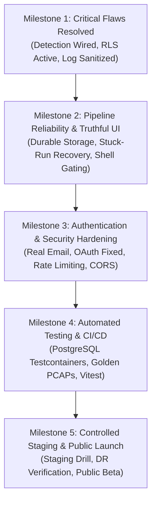

# Velorix Sentinel — Production Readiness Implementation Plan

| Metadata | Details |
|---|---|
| **Project** | Velorix Sentinel (Deep Packet Inspection & Threat Detection) |
| **Document Purpose** | Comprehensive, dependency-aware implementation plan to achieve production readiness and public beta launch |
| **Audit Baseline** | `VELORIX_SENTINEL_PRODUCTION_READINESS_AUDIT.md` (19 Oct 2026) |
| **Target Architecture** | Netlify (Frontend) + Render (Spring Boot 3.5.0, Java 21) + Supabase (PostgreSQL 16) + S3-Compatible Object Store |
| **Author** | Antigravity AI Engineering & Security Architecture |
| **Status** | PLANNING ONLY (Zero code modified, zero dependencies installed) |

---

## 1. Executive Summary & Scope Alignment

The static production-readiness audit of Velorix Sentinel confirmed that the system has an exceptionally solid foundational architecture:
- Memory-safe, bounded streaming PCAP/PCAPNG readers.
- Strict owner-scoped data access (`CurrentUserProvider.ownerScope()`).
- Modern cryptographic primitives: BCrypt-12, SHA-256 hashed refresh and verification tokens, 64-byte minimum HMAC-SHA512 JWT keys.
- Hardened upload intake (magic-byte validation, atomic file operations, deduplication).
- Flyway-managed schema discipline with CHECK constraints and partial indexes.

However, the audit revealed **critical defects and disconnects** that prevent safe public release:
1. **The headline feature never runs:** Threat detection is never invoked by the inspection pipeline or frontend, and risk scores default to 0, producing a misleading green **"Secure"** badge (C1, H1).
2. **Account recovery is inoperative and insecure:** Verification and password reset URLs containing raw tokens are written to server logs, email delivery is a mock, and password login ignores email verification (C3, H2, H3).
3. **Database exposure on Supabase:** No Row Level Security (RLS) policies exist, risking full table exposure via PostgREST (C2).
4. **Marketing and UI overstatement:** ~62% of UI routes are unbacked shells, AI Copilot has no backend, and landing page claims cite features that do not exist (H6, §5).
5. **Operational and storage vulnerabilities:** Captures sit on ephemeral container disks without quotas (H5), dropped worker queues leave runs permanently stuck (H4), and tests run exclusively on in-memory H2 with Flyway disabled (H9).

### The Initial Public Beta Target Scope
To achieve a safe, honest, and high-quality launch without endless re-architecture, the scope for the **Initial Public Beta** is strictly bounded:
> **Beta Core:** PCAP / PCAPNG Upload → Streaming Deep Packet Inspection & Decoding → Automated Rule-Based Threat Detection (13 Rules) → Threat Intelligence Findings Feed & Network Analytics Dashboard.

All unbuilt modules (Incident Response, SOC Workspace, Live SPAN/TAP, External SIEM integrations, AI Copilot, Governance/Board reports) will be gracefully feature-flagged out of navigation or explicitly badged as "Preview / Planned".

---

## 2. Milestone Roadmap



- **Milestone 1: Critical Problems Resolved (P0)**
  - Automated threat detection runs asynchronously after packet inspection.
  - "Secure" and "CLEAN" badges are strictly conditional on real verdicts.
  - Supabase RLS enabled with API roles revoked.
  - Plaintext tokens removed from logs; log level set to INFO.
- **Milestone 2: Core Product Functionality Verified (P0)**
  - Captures backed by durable object storage with per-user quotas.
  - Run rejection and stuck-run reaper implemented.
  - Public marketing claims corrected; unbuilt UI routes hidden.
- **Milestone 3: Authentication & Database Secured (P0 / P1)**
  - Transactional email delivery functional; email verification enforced.
  - OAuth account-linking flaw and callback race condition eliminated.
  - Rate limiting on authentication endpoints; refresh token reuse detection.
  - Strict CORS origin filtering; Netlify security headers deployed.
- **Milestone 4: Automated Testing & Deployment Validated (P1)**
  - Integration test suite running on PostgreSQL Testcontainers with Flyway migrations.
  - Unit test coverage for all 13 detection rules with golden PCAP fixtures.
  - Automated CI/CD pipeline blocking pull requests on test or security scan failure.
- **Milestone 5: Ready for a Controlled Public Beta (P1 / Launch)**
  - End-to-end staging smoke tests passed across all supported capture formats.
  - Backup restore and disaster recovery drill completed.
  - Structured observability, health probes, and alert thresholds active.

---

## 3. Phase-by-Phase Task Breakdown

---

### Phase 1: Threat Detection Engine Wiring & Pipeline Reliability

#### Task 1.1: Automated Asynchronous Detection Execution (C1, M4)
- **Problem Addressed:** `InspectionServiceImpl.execute` marks an analysis `COMPLETED` immediately after packet storage without ever invoking `DetectionService.run`. Threat detection is only callable via manual `POST /api/v1/threats/run/{analysisId}`, which no frontend code calls. Additionally, `DetectionServiceImpl.run` executes synchronously inside a single `@Transactional` method over up to 5,000,000 packets, holding a pooled Hikari connection and risking gateway timeouts.
- **Proposed Solution:**
  1. Introduce an asynchronous pipeline stage: when `InspectionEngine.inspect()` succeeds, transition analysis status to `ANALYZING` (or execute detection immediately on a background executor).
  2. Decouple `DetectionServiceImpl.run` from the caller's HTTP thread and ambient security context. Wrap the detection execution in a worker job with proper internal transaction boundaries (streaming packets read-only in chunks, persisting findings in a separate transaction).
  3. Ensure that when running asynchronously, the background thread uses system/internal permissions (or passes the owner `userId` explicitly to `AnalysisRepository.findWithDetailsById`) rather than relying on `CurrentUserProvider.ownerScope()` which is null on background threads.
  4. Implement concurrency control: guard against duplicate detection runs for the same analysis using a database lock or status check.
- **Exact Files/Components:**
  - `backend/src/main/java/com/velorix/sentinel/service/impl/InspectionServiceImpl.java`
  - `backend/src/main/java/com/velorix/sentinel/service/impl/DetectionServiceImpl.java`
  - `backend/src/main/java/com/velorix/sentinel/service/AnalysisRunStateService.java`
  - `backend/src/main/java/com/velorix/sentinel/detection/ThreatDetectionEngine.java`
  - `backend/src/main/java/com/velorix/sentinel/controller/ThreatController.java`
- **Dependencies:** None. Independent core fix.
- **Potential Risks & Side Effects:** High packet count captures may consume CPU on the worker thread for several seconds; executor pool sizing (`dpi-` pool) must ensure detection does not starve incoming packet ingestion.
- **Verification Tests:**
  - `InspectionPipelineIntegrationTest`: Upload a port-scan PCAP; verify detection runs automatically and creates `Threat` rows without manual API intervention.
  - Concurrency test: Trigger concurrent detection requests on the same completed analysis; verify exactly one executes and no duplicate findings are created.
- **Acceptance Criteria:**
  - After upload and inspection of any PCAP, `threatService.findByAnalysis(id)` returns detected threats automatically.
  - No HTTP timeout occurs on large captures.
  - Analysis status progression is strictly `QUEUED` → `PROCESSING` → `COMPLETED` (or `ANALYZING` → `COMPLETED`).

---

#### Task 1.2: Packet & Analysis Integrity — Real Suspicious & Malicious Indicators (H1)
- **Problem Addressed:** `PacketBatchWriter.java:82` hard-codes `is_suspicious = false` for every packet written to PostgreSQL. `Analysis.maliciousPackets` and `Analysis.safePackets` are never calculated. The frontend renders "CLEAN" on packets and displays misleading "0 malicious / 0 clean frames" widgets.
- **Proposed Solution:**
  1. Update detection engine findings collection: every `ThreatCandidate` references sample packet frame numbers.
  2. Upon detection completion, aggregate all unique flagged packet numbers.
  3. Execute a bulk JDBC update: `UPDATE packets SET is_suspicious = true WHERE analysis_id = ? AND frame_number IN (?)`.
  4. Calculate `maliciousPackets` as the distinct count of suspicious packets (or count of frames associated with threats) and `safePackets = totalPackets - maliciousPackets`. Persist these values to `Analysis` and `AnalysisSummary`.
  5. In frontend `PacketDetailSheet.tsx` and `PacketTable.tsx`, display "SUSPICIOUS" badge if `is_suspicious = true`, and "UNFLAGGED" (instead of definitive "CLEAN") if false.
- **Exact Files/Components:**
  - `backend/src/main/java/com/velorix/sentinel/inspection/PacketBatchWriter.java`
  - `backend/src/main/java/com/velorix/sentinel/service/impl/DetectionServiceImpl.java`
  - `backend/src/main/java/com/velorix/sentinel/entity/Analysis.java`
  - `backend/src/main/java/com/velorix/sentinel/entity/AnalysisSummary.java`
  - `src/components/packets/PacketDetailSheet.tsx`
  - `src/components/packets/PacketTable.tsx`
  - `src/components/analysis/AnalysisOverviewPanel.tsx`
- **Dependencies:** Task 1.1 (Detection must run to identify suspicious packets).
- **Potential Risks & Side Effects:** Updating millions of packet rows individually would be slow; update must be done via JDBC batching only for the frame numbers that actually triggered findings.
- **Verification Tests:**
  - Ingestion & detection test with a known SYN flood PCAP: assert `Analysis.maliciousPackets > 0` and `packets` table contains rows with `is_suspicious = true`.
  - Verify packet table UI filter for "Suspicious" displays flagged packets.
- **Acceptance Criteria:**
  - In an infected capture, `maliciousPackets` reflects actual flagged packet count.
  - Individual malicious packets show "SUSPICIOUS" badge with corresponding rule tag in packet browser.
  - Clean captures show 0 malicious packets and `safePackets = totalPackets`.

---

#### Task 1.3: Risk Score Synchronization & Explicit "Not Scanned" UI State (C1, L3)
- **Problem Addressed:** Analyses default to `risk_score = 0`. Frontend `risk-band.ts` and backend `RiskScorer.java` have divergent thresholds (e.g. backend considers score 50 `HIGH_RISK`, frontend requires 60; backend considers 25 `ELEVATED`, frontend requires 40). Crucially, a default score of 0 renders a bright green "Secure" badge, misleading users before detection even runs.
- **Proposed Solution:**
  1. Add an explicit state in backend `OverallStatus` and frontend: `PENDING_SCAN` or nullable `overallStatus`. An analysis whose detection pass has not yet executed must never report `OverallStatus.SECURE`.
  2. Harmonize thresholds across backend `RiskScorer.java` and frontend `src/components/common/risk-band.ts`:
     - Critical: Risk Score ≥ 80 or Critical Threats > 0
     - High: Risk Score ≥ 50 or High Threats > 0
     - Elevated: Risk Score ≥ 25
     - Low: Risk Score > 0
     - Secure: Risk Score = 0 **AND** status is `COMPLETED` with detection executed.
  3. Update frontend UI components (`AnalysisRunList.tsx`, `RecentAnalysesTable.tsx`, `AnalysisOverviewPanel.tsx`, `RiskBadge.tsx`) to render an amber/blue "Awaiting Scan" or "Processing" badge whenever detection is not yet finalized.
- **Exact Files/Components:**
  - `backend/src/main/java/com/velorix/sentinel/entity/enums/OverallStatus.java`
  - `backend/src/main/java/com/velorix/sentinel/detection/RiskScorer.java`
  - `backend/src/main/java/com/velorix/sentinel/entity/AnalysisSummary.java`
  - `src/components/common/risk-band.ts`
  - `src/components/common/RiskBadge.tsx`
  - `src/components/analysis/AnalysisOverviewPanel.tsx`
  - `src/components/dashboard/RecentAnalysesTable.tsx`
- **Dependencies:** Task 1.1.
- **Potential Risks & Side Effects:** UI tests expecting "Secure" for newly created analyses will fail until updated.
- **Verification Tests:**
  - Unit tests verifying `RiskScorer.status()` and frontend `riskBand()` produce identical labels and bands for all integer scores 0–100.
  - UI state test verifying an in-progress or unscanned analysis renders "Scanning..." or "Awaiting Scan", never "Secure".
- **Acceptance Criteria:**
  - No analysis shows "Secure" until detection has executed and verified 0 findings.
  - Risk scores of 25, 50, and 80 render identical classifications in both API JSON and frontend UI badges.

---

#### Task 1.4: Resilient Packet Parsing & Truncated Capture Tolerance (M7)
- **Problem Addressed:** `PcapStreamReader.java:93` calls `cursor.readFully(buffer, 0, capturedLength)`. If a capture was interrupted mid-frame (e.g. `tcpdump` terminated with SIGINT), `EOFException` is thrown. `InspectionEngine.java:78` catches `IOException` and rethrows `CaptureFormatException`, causing the entire run to fail and discarding all previously parsed valid frames.
- **Proposed Solution:**
  1. In `PcapStreamReader` and `PcapNgStreamReader`, catch `EOFException` specifically during frame body read.
  2. If EOF occurs after successfully parsing ≥ 1 valid frames, log a warning, mark the run as `is_truncated = true`, and cleanly terminate the stream read loop.
  3. In `InspectionEngine.java`, record `run.truncated = true` and allow `InspectionProgress` to complete normally with the valid packets saved up to the truncation point.
  4. Expose `truncated` flag in `AnalysisResponse` and display a warning banner in the frontend analysis overview: *"Capture truncated: inspection completed on all available frames before file end."*
- **Exact Files/Components:**
  - `backend/src/main/java/com/velorix/sentinel/inspection/reader/PcapStreamReader.java`
  - `backend/src/main/java/com/velorix/sentinel/inspection/reader/PcapNgStreamReader.java`
  - `backend/src/main/java/com/velorix/sentinel/inspection/InspectionEngine.java`
  - `backend/src/main/java/com/velorix/sentinel/dto/analysis/AnalysisResponse.java`
  - `backend/src/main/resources/db/migration/V7__production_hardening.sql` (add `truncated BOOLEAN NOT NULL DEFAULT FALSE` to `analyses`)
  - `src/components/analysis/AnalysisOverviewPanel.tsx`
- **Dependencies:** None. Independent parser improvement.
- **Potential Risks & Side Effects:** Must distinguish between a truncated header (0 valid packets parsed → should still fail) and a truncated file tail.
- **Verification Tests:**
  - Test with a synthetic truncated PCAP file (file cut in half): verify parsing succeeds for the first N packets, sets `truncated = true`, and allows threat detection to evaluate available frames.
- **Acceptance Criteria:**
  - Tail-truncated PCAPs complete with status `COMPLETED` and `truncated = true`.
  - Zero-byte or corrupted header PCAPs fail with `CaptureFormatException`.

---

#### Task 1.5: Protocol Decoder Expansion — 802.1Q VLAN & Fragment Handling (M8)
- **Problem Addressed:** In `PacketDecoder.java:106-139`, frames are checked with `instanceof IpV4Packet`, `instanceof IpV6Packet`, or `instanceof ArpPacket`. 802.1Q VLAN-tagged frames (`Dot1qVlanTagPacket`) fall directly into the `OTHER` branch, assigning `-` as source and destination addresses. This blinds all detection rules for any VLAN-tagged enterprise traffic. Additionally, TCP flags ECE/CWR are dropped.
- **Proposed Solution:**
  1. In `PacketDecoder.java`, unwrap encapsulation layers: if packet payload is an instance of `Dot1qVlanTagPacket` (or QinQ double-tagged), extract the inner payload and recurse into network layer decoding.
  2. Preserve VLAN ID metadata in `DecodedPacket` if desired, or at minimum decode the inner IP layer.
  3. Decode full TCP flag bitmask: preserve SYN, ACK, FIN, RST, PSH, URG, ECE, CWR in `DecodedPacket.tcpFlags()`.
  4. Add basic IPv4 fragment awareness: check fragmentation flags and fragment offset; mark fragmented packets so rules do not misinterpret partial TCP headers.
- **Exact Files/Components:**
  - `backend/src/main/java/com/velorix/sentinel/inspection/decoder/PacketDecoder.java`
  - `backend/src/main/java/com/velorix/sentinel/inspection/model/DecodedPacket.java`
- **Dependencies:** None.
- **Potential Risks & Side Effects:** Deeply nested tunnels (e.g. GRE/IP-in-IP) could trigger recursion; cap unwrapping depth to 3 layers.
- **Verification Tests:**
  - Unit test with a VLAN-tagged PCAP: assert `sourceIp` and `destinationIp` are correctly populated with valid IPv4/IPv6 addresses, not `-`.
  - Unit test verifying all 8 TCP flags are mapped into the flags string.
- **Acceptance Criteria:**
  - VLAN 802.1Q tagged packets have valid IP and transport decoding.
  - Threat detection rules fire accurately on VLAN-tagged traffic.

---

#### Task 1.6: Detection Rule Refinement & False-Positive Mitigation (M9)
- **Problem Addressed:**
  - `BruteForceRule.java`: Counts SYNs over the entire capture without any sliding time window (30 SYNs across a 2-hour capture flags HIGH, even for routine SMB/LDAP traffic).
  - `DnsAnomalyRule.java`: Flags payloads > 512 bytes as DNS tunneling, which causes false alarms on standard EDNS0 and DNSSEC queries.
  - `DataExfiltrationRule.java`: Hardcoded threshold requires ≥ 50 MB outbound data, which can barely trigger given the 100 MB total upload file limit.
  - 8 of 13 detection rules lack automated test coverage.
- **Proposed Solution:**
  1. Refactor `BruteForceRule`: require ≥ 30 failed attempts within a 60-second sliding window.
  2. Refactor `DnsAnomalyRule`: increase payload threshold to 1232 bytes (standard modern EDNS buffer size) or check for high-entropy subdomain strings instead of simple packet size.
  3. Refactor `DataExfiltrationRule`: scale threshold to either absolute (e.g. 10 MB) or relative (e.g. > 40% of total outbound bytes to a single unclassified external IP).
  4. Make thresholds configurable in `DetectionProperties.java` so operators can tune them via environment variables without code redeploys.
  5. Write unit tests for all untested rules: `AbnormalPacketSizeRule`, `DataExfiltrationRule`, `DdosRule`, `DnsAnomalyRule`, `RepeatedConnectionRule`, `SuspiciousExternalCommRule`, `UdpScanRule`, `UnknownProtocolRule`.
- **Exact Files/Components:**
  - `backend/src/main/java/com/velorix/sentinel/detection/rules/*.java`
  - `backend/src/main/java/com/velorix/sentinel/config/properties/DetectionProperties.java`
  - `backend/src/test/java/com/velorix/sentinel/detection/DetectionRulesTest.java`
- **Dependencies:** Task 1.1.
- **Potential Risks & Side Effects:** Altering thresholds changes threat counts; ensure golden PCAP test baselines are updated and documented.
- **Verification Tests:**
  - Unit tests for all 13 rules testing both positive detections and benign traffic non-detections.
  - Benchmark test verifying memory consumption stays bounded under 200,000 tracked keys.
- **Acceptance Criteria:**
  - Normal EDNS0/DNSSEC traffic does not trigger DNS Tunneling alerts.
  - All 13 detection rules have comprehensive positive and negative unit tests.

---

### Phase 2: Supabase PostgreSQL, Migrations & Database Security

#### Task 2.1: Supabase Row Level Security (RLS) & Grant Migration (C2)
- **Problem Addressed:** Flyway migrations V1–V6 create all tables in schema `public` with no RLS enabled and no role permission revocations. When deployed on Supabase, the public PostgREST API exposes all tables using the project's public anon key. Anyone with the anon key could query or manipulate `users` (including BCrypt password hashes), `refresh_tokens`, `verification_tokens`, captures, and threats.
- **Proposed Solution:**
  1. Author Flyway migration `V7__supabase_security_and_rls.sql`.
  2. Execute `ALTER TABLE <table_name> ENABLE ROW LEVEL SECURITY;` on all tables: `users`, `refresh_tokens`, `verification_tokens`, `activity_logs`, `uploaded_files`, `analyses`, `analysis_summaries`, `packets`, `threats`, `detection_rules`.
  3. By default, with RLS enabled and zero permissive policies defined, all access via PostgREST (`anon` and `authenticated` roles) is completely blocked (returns empty/401).
  4. Explicitly revoke permissions from Supabase API roles:
     ```sql
     REVOKE ALL ON ALL TABLES IN SCHEMA public FROM anon, authenticated;
     REVOKE ALL ON ALL SEQUENCES IN SCHEMA public FROM anon, authenticated;
     REVOKE ALL ON ALL ROUTINES IN SCHEMA public FROM anon, authenticated;
     ```
  5. Ensure the Spring Boot backend database user (e.g. `postgres` or `service_role`) retains full schema ownership and permissions.
  6. Add an automated integration test verifying that a simulated `anon` role query fails or returns zero rows.
- **Exact Files/Components:**
  - `backend/src/main/resources/db/migration/V7__supabase_security_and_rls.sql`
  - `backend/src/test/java/com/velorix/sentinel/security/SupabaseRlsVerificationTest.java`
- **Dependencies:** None. Independent database security task.
- **Potential Risks & Side Effects:** If Spring Boot connects using the `anon` or `authenticated` role instead of the primary DB owner/pooler user, it would be blocked. Must verify connection string uses the dedicated pooler/service role.
- **Verification Tests:**
  - Connect to staging Supabase with anon JWT key and attempt `SELECT * FROM users;` → must return 401 / empty array.
  - Verify Spring Boot integration tests continue to run successfully with full CRUD access.
- **Acceptance Criteria:**
  - All 10 public tables have RLS enabled.
  - PostgREST anon API queries return 0 records and allow 0 writes.
  - Spring Boot backend functions normally without connection issues.

---

#### Task 2.2: Case-Insensitive Email Index & Schema Cleanliness (L6, §3)
- **Problem Addressed:**
  - `V1:22` creates a unique constraint on `email`, but PostgreSQL unique constraints are case-sensitive. The backend calls `findByEmailIgnoreCase(email)`, which cannot use a standard index efficiently on large tables.
  - `V6:45-59` created table `detection_rules`, but there is no Java JPA entity or repository for it; rule toggles are managed purely via `application.yml` (`detection.disabled-rules`).
- **Proposed Solution:**
  1. In `V7`, add a unique functional index: `CREATE UNIQUE INDEX IF NOT EXISTS uk_users_lower_email ON users (LOWER(email));`.
  2. Standardize `detection_rules`: either map a lightweight JPA entity `DetectionRuleEntity` to allow runtime rule management, or drop the unused table in migration V7 to avoid schema drift.
- **Exact Files/Components:**
  - `backend/src/main/resources/db/migration/V7__supabase_security_and_rls.sql`
  - `backend/src/main/java/com/velorix/sentinel/entity/User.java`
- **Dependencies:** Task 2.1.
- **Potential Risks & Side Effects:** Creating `LOWER(email)` unique index requires that no duplicate case-varying emails exist in the database.
- **Verification Tests:**
  - Flyway migration test: verify V7 applies cleanly on PostgreSQL.
  - Attempt inserting `User@Example.com` and `user@example.com` → verify database-level conflict.
- **Acceptance Criteria:**
  - `LOWER(email)` has an enforced unique index.
  - No orphaned unmapped tables exist in the schema.

---

#### Task 2.3: Data Lifecycle, Retention Purging & Index Optimization (M10)
- **Problem Addressed:** Captures can produce millions of packet rows (each with 8 secondary indexes). Without scheduled cleanup, database storage costs escalate rapidly on Supabase. Expired refresh tokens, expired verification tokens, old activity logs, and soft-deleted files are never purged.
- **Proposed Solution:**
  1. Implement a Spring `@Scheduled` maintenance service (`DatabaseRetentionService.java`):
     - Daily purge of expired, revoked refresh tokens (`WHERE expires_at < NOW() - INTERVAL '30 days'`).
     - Daily purge of consumed/expired verification tokens (`WHERE expires_at < NOW() - INTERVAL '7 days'`).
     - Purge activity logs older than retention policy (e.g. 90 days).
     - Hard delete soft-deleted files and orphaned packet/threat rows after 30 days.
  2. Optimize `packets` table indexes: evaluate whether all 8 secondary indexes are necessary. Keep indexes critical for UI querying (`analysis_id`, `frame_number`, `source_ip`, `destination_ip`, `protocol`); remove redundant composite indexes that degrade batch insert performance.
- **Exact Files/Components:**
  - `backend/src/main/java/com/velorix/sentinel/service/impl/DatabaseRetentionService.java`
  - `backend/src/main/resources/db/migration/V7__supabase_security_and_rls.sql`
  - `backend/src/main/java/com/velorix/sentinel/config/SchedulingConfig.java`
- **Dependencies:** Task 2.1.
- **Potential Risks & Side Effects:** Running large `DELETE` queries can lock tables; retention cleanup must delete in batches (e.g. `LIMIT 5000`) and run during off-peak hours.
- **Verification Tests:**
  - Unit/integration test for `DatabaseRetentionService`: populate expired tokens and assert they are deleted when scheduled task runs.
- **Acceptance Criteria:**
  - Expired tokens and stale records are automatically purged without manual DBA intervention.
  - Batch insert speed for packets is maintained under high throughput.

---

#### Task 2.4: Pagination & Sort Traversal Protection (L8)
- **Problem Addressed:** `PageRequestParams.java` allows any dotted property path in `sort`, enabling expensive database `ORDER BY` operations on large unindexed columns or entity relationship traversals.
- **Proposed Solution:**
  1. Add an allowlist of valid sortable properties per entity in `PageRequestParams.java` or in individual controller endpoints (e.g. `Analysis`: `createdAt`, `totalPackets`, `riskScore`; `Packet`: `frameNumber`, `timestamp`).
  2. Reject sorting requests on unindexed or non-allowlisted properties with HTTP 400 Bad Request instead of passing them to JPA.
- **Exact Files/Components:**
  - `backend/src/main/java/com/velorix/sentinel/dto/common/PageRequestParams.java`
  - `backend/src/main/java/com/velorix/sentinel/controller/AnalysisController.java`
  - `backend/src/main/java/com/velorix/sentinel/controller/PacketController.java`
- **Dependencies:** None.
- **Potential Risks & Side Effects:** Frontend components requesting custom sort fields must be checked against the allowlist.
- **Verification Tests:**
  - Test `GET /api/v1/analyses?sort=invalidField,desc` returns 400 Bad Request with a clear validation error.
- **Acceptance Criteria:**
  - Dotted and arbitrary sort expressions are strictly blocked.
  - Only indexed, allowlisted fields are accepted for sorting.

---

### Phase 3: Authentication, OAuth, Account Recovery & Abuse Defense

#### Task 3.1: Transactional Email Integration & Token Log Redaction (C3)
- **Problem Addressed:** `LoggingEmailService.java` is the sole `EmailService` bean. It logs the full verification and password reset URLs (including live security tokens) at INFO level. Real users cannot verify accounts or reset passwords, while anyone with log access can take over any account.
- **Proposed Solution:**
  1. Add `spring-boot-starter-mail` and a dedicated transactional email client (e.g. Resend, Postmark, AWS SES, or standard SMTP) to `pom.xml`.
  2. Implement `TransactionalEmailService.java` implementing `EmailService`: sends real multipart HTML/text emails using templates for verification, password reset, and security notifications.
  3. Ensure `LoggingEmailService` is strictly relegated to `@Profile("test")` or removed.
  4. Redact security tokens from all log outputs: log only `"[email] Verification email dispatched to {}"`, never the token or full URL.
  5. In `application.yml`, set `logging.level.com.velorix.sentinel: ${LOG_LEVEL_APP:INFO}` (changing default from DEBUG to INFO).
- **Exact Files/Components:**
  - `backend/pom.xml`
  - `backend/src/main/java/com/velorix/sentinel/service/impl/TransactionalEmailService.java`
  - `backend/src/main/java/com/velorix/sentinel/service/impl/LoggingEmailService.java`
  - `backend/src/main/resources/application.yml`
  - `backend/src/main/resources/templates/email/*.html` (email templates)
- **Dependencies:** Mail provider API key or SMTP credentials configured in staging/prod.
- **Potential Risks & Side Effects:** Email provider delivery failures must be handled gracefully with appropriate retry/circuit-breaker logic so registration does not hang.
- **Verification Tests:**
  - Mock mail server test (GreenMail / Testcontainers): trigger registration and password reset; verify email payload arrives with correct link and no token appears in captured logs.
- **Acceptance Criteria:**
  - Password reset and email verification deliver real emails to users' inboxes.
  - Zero raw tokens, reset links, or passwords appear in server logs at any log level.

---

#### Task 3.2: Email Verification Enforcement & Registration Hardening (C3, L1, L2)
- **Problem Addressed:** `AuthServiceImpl.login` does not check `user.isVerified()`. Users can register with fake or unowned email addresses and immediately access the platform. Furthermore, registration returns HTTP 409 when an email exists (enabling user enumeration, L1), and password policies count characters instead of UTF-8 bytes (L2).
- **Proposed Solution:**
  1. In `AuthServiceImpl.login()`, verify `if (!user.isVerified()) throw new ForbiddenException("Email verification is required before login.");`.
  2. Provide a clean resend verification flow (`/api/v1/auth/resend-verification`) that is rate-limited.
  3. In `AuthServiceImpl.register()`, handle existing email gracefully: do not disclose whether the email exists, or return a generic "Verification link sent if account eligible" message, or align enumeration policies consistently.
  4. In `StrongPasswordValidator.java`, validate password byte length (`password.getBytes(StandardCharsets.UTF_8).length <= 72`) to prevent BCrypt truncation attacks, and reject common passwords.
  5. Update frontend `register.tsx` and `AuthContext.tsx`: after registration, do not immediately set session; instead, navigate to `/verify-email?email=...` displaying instructions to check inbox.
- **Exact Files/Components:**
  - `backend/src/main/java/com/velorix/sentinel/service/impl/AuthServiceImpl.java`
  - `backend/src/main/java/com/velorix/sentinel/security/validation/StrongPasswordValidator.java`
  - `src/context/AuthContext.tsx`
  - `src/routes/register.tsx`
  - `src/routes/verify-email.tsx`
- **Dependencies:** Task 3.1.
- **Potential Risks & Side Effects:** Existing unverified test accounts will no longer be able to log in without verification; ensure DB migration marks existing admin accounts as verified.
- **Verification Tests:**
  - Integration test: Register a new account → attempt login immediately → assert 403 Forbidden. Apply verification token → attempt login → assert 200 OK.
  - Password validator test: Pass 73-byte UTF-8 multibyte password → assert validation error.
- **Acceptance Criteria:**
  - No unverified user can authenticate or access protected endpoints.
  - Frontend clearly guides user through the email confirmation step.

---

#### Task 3.3: OAuth Account-Linking Security & Pre-Account Takeover Defense (H2)
- **Problem Addressed:** `AuthServiceImpl.loginWithOAuth` looks up any existing account by email and automatically sets `verified = true`. Because registration previously required no verification, an attacker could pre-register `victim@company.com` with a password known to the attacker. When the victim signs in with Google/GitHub, the account is validated, but the attacker's password and refresh tokens remain active, allowing full account takeover.
- **Proposed Solution:**
  1. In `OAuth2LoginSuccessHandler.java`, verify provider verification claims: for Google, require `email_verified == true`; for GitHub, verify `primary` and `verified` email attributes.
  2. Track OAuth identity explicitly: add `oauth_provider` and `oauth_provider_id` columns to `users` table (`V7`).
  3. When an OAuth login matches a pre-existing local account:
     - If the local account was never verified: revoke all existing sessions, clear the local password (or require a password reset confirmation), link the OAuth provider, and mark verified.
     - If the local account was already verified: require explicit re-authentication or send a security alert email notifying the user that an OAuth provider was linked.
- **Exact Files/Components:**
  - `backend/src/main/java/com/velorix/sentinel/service/impl/AuthServiceImpl.java`
  - `backend/src/main/java/com/velorix/sentinel/security/OAuth2LoginSuccessHandler.java`
  - `backend/src/main/java/com/velorix/sentinel/security/GitHubOAuth2UserService.java`
  - `backend/src/main/resources/db/migration/V7__supabase_security_and_rls.sql`
- **Dependencies:** Task 3.1, Task 3.2.
- **Potential Risks & Side Effects:** Users who legitimately created an unverified password account and switch to Google OAuth will have their old password invalidated and will use OAuth exclusively.
- **Verification Tests:**
  - Security integration test: Register `victim@test.com` with password. Simulate unverified state. Simulate OAuth login from Google for `victim@test.com`. Verify previous refresh tokens are revoked and old password cannot authenticate.
- **Acceptance Criteria:**
  - Pre-registered unverified accounts cannot be hijacked via OAuth linking.
  - Google/GitHub accounts without verified emails are rejected.

---

#### Task 3.4: OAuth Callback Race Condition & Proxy Headers (H3)
- **Problem Addressed:**
  - **Frontend race:** In `src/context/AuthContext.tsx:134-140`, `completeOAuthLogin` calls `authService.currentUser()` before calling `persistSession()`. The Axios interceptor checks `getAccessToken()`, finds it empty, sends an unauthenticated `/auth/me` request, gets 401, clears auth, and redirects back to `/login`. OAuth login fails 100% of the time.
  - **Proxy headers:** On Render behind reverse-proxy TLS termination, Spring Boot builds redirect URIs with `http://` unless `server.forward-headers-strategy=framework` is configured, causing OAuth providers to reject redirect URI mismatch.
- **Proposed Solution:**
  1. In `src/context/AuthContext.tsx`, fix `completeOAuthLogin`:
     ```ts
     const completeOAuthLogin = useCallback(
       async (tokens: Omit<AuthSession, "user">) => {
         // Persist tokens first so Axios interceptor has access to Authorization header
         persistSession({ ...tokens, user: null });
         try {
           const user = await authService.currentUser();
           persistSession({ ...tokens, user });
         } catch (error) {
           clearSession();
           throw error;
         }
       },
       [persistSession, clearSession],
     );
     ```
  2. In `backend/src/main/resources/application.yml`, configure forward headers:
     ```yaml
     server:
       forward-headers-strategy: framework
     ```
  3. Add `ForwardedHeaderFilter` bean if needed for older servlet containers.
- **Exact Files/Components:**
  - `src/context/AuthContext.tsx`
  - `src/routes/oauth.callback.tsx`
  - `backend/src/main/resources/application.yml`
  - `backend/src/main/java/com/velorix/sentinel/config/SecurityConfig.java`
- **Dependencies:** None.
- **Potential Risks & Side Effects:** Forwarded headers must only be trusted from the Render reverse proxy (covered under Task 3.8).
- **Verification Tests:**
  - Unit test in frontend simulating OAuth callback: verify `persistSession` is called before `/auth/me` is dispatched.
  - Verify redirect URI generated by Spring Security starts with `https://`.
- **Acceptance Criteria:**
  - Successful OAuth sign-in with Google/GitHub completes smoothly and lands on `/dashboard` without 401 redirect to `/login`.

---

#### Task 3.5: OAuth One-Time Code Exchange Hardening (H3)
- **Problem Addressed:** `OAuth2LoginSuccessHandler.java:45-50` transmits sensitive access and refresh tokens directly in the URL fragment (`#accessToken=...&refreshToken=...`). Fragments can be leaked via browser history, extensions, or DOM inspection.
- **Proposed Solution:**
  1. Replace URL fragment token delivery with an authorization code flow:
     - Upon successful OAuth authentication, generate a cryptographically random, short-lived (60-second), single-use `oauth_exchange_code`.
     - Store the code in a cache or table with the associated session.
     - Redirect to `/oauth/callback?code=<exchange_code>`.
  2. Add backend endpoint: `POST /api/v1/auth/oauth/exchange` accepting `{ code: string }`, which validates, consumes the single-use code, and returns the tokens in a secure JSON response body.
  3. Update `src/routes/oauth.callback.tsx` to read the query parameter `code` and invoke `authService.exchangeOAuthCode(code)`.
- **Exact Files/Components:**
  - `backend/src/main/java/com/velorix/sentinel/security/OAuth2LoginSuccessHandler.java`
  - `backend/src/main/java/com/velorix/sentinel/controller/AuthController.java`
  - `backend/src/main/java/com/velorix/sentinel/service/AuthService.java`
  - `backend/src/main/java/com/velorix/sentinel/service/impl/AuthServiceImpl.java`
  - `src/routes/oauth.callback.tsx`
  - `src/services/authService.ts`
- **Dependencies:** Task 3.4.
- **Potential Risks & Side Effects:** Requires coordinated frontend and backend update.
- **Verification Tests:**
  - Test exchange code: code can be exchanged exactly once; replaying an exchange code returns 401. Expired codes (>60s) return 401.
- **Acceptance Criteria:**
  - No access or refresh tokens are exposed in URL bars, query strings, or fragments.

---

#### Task 3.6: Refresh Token Reuse Detection & Concurrency Row Locking (M3)
- **Problem Addressed:** In `RefreshTokenServiceImpl.java:72-104`, rotating a refresh token lacks reuse detection. If a stolen refresh token is replayed after already being rotated, it merely fails silently without revoking the token family. Furthermore, `requireUsable` is read-only and un-locked, meaning two concurrent refresh requests can race and succeed simultaneously.
- **Proposed Solution:**
  1. Implement Token Family tracking: add `family_id UUID` and `previous_token_hash VARCHAR` to `refresh_tokens` (`V7`).
  2. Implement Pessimistic Row Locking on token rotation:
     ```java
     @Lock(LockModeType.PESSIMISTIC_WRITE)
     @Query("SELECT r FROM RefreshToken r WHERE r.tokenHash = :hash")
     Optional<RefreshToken> findByTokenHashWithLock(@Param("hash") String hash);
     ```
  3. Implement Reuse Detection: if a refresh request presents a token that exists in the database but is already marked `revoked = true`, treat this as a compromised token event:
     - Immediately invoke `revokeFamily(token.getFamilyId())` or `revokeAllForUser(token.getUser())`.
     - Log a high-severity security alert in `activity_logs`.
     - Throw `TokenException("Suspicious token reuse detected; all sessions revoked.")`.
- **Exact Files/Components:**
  - `backend/src/main/java/com/velorix/sentinel/entity/RefreshToken.java`
  - `backend/src/main/java/com/velorix/sentinel/repository/RefreshTokenRepository.java`
  - `backend/src/main/java/com/velorix/sentinel/service/impl/RefreshTokenServiceImpl.java`
  - `backend/src/main/resources/db/migration/V7__supabase_security_and_rls.sql`
- **Dependencies:** Task 2.1.
- **Potential Risks & Side Effects:** Concurrent requests from multiple browser tabs on page load must be handled smoothly (a brief grace period or frontend deduplication of the refresh call in `apiClient.ts`).
- **Verification Tests:**
  - Refresh reuse test: Obtain Token A. Rotate Token A to Token B. Present Token A a second time. Assert Token B is immediately revoked and user must re-authenticate.
- **Acceptance Criteria:**
  - Token replay results in automatic revocation of all associated sessions.
  - Concurrent refresh attempts do not create duplicate valid sessions.

---

#### Task 3.7: Rate Limiting & CPU-DoS Defense (H7)
- **Problem Addressed:** No rate limiting exists across the application. Endpoints like `/api/v1/auth/login` (which executes CPU-intensive BCrypt-12 hashing), `/api/v1/auth/register`, `/api/v1/auth/forgot-password`, and `/api/v1/files/upload` (100 MB payload) can be flooded to exhaust server CPU, memory, and transactional email quotas.
- **Proposed Solution:**
  1. Integrate Bucket4j (or Spring Cloud Gateway / Redis token bucket filter) into the backend.
  2. Define rate-limiting tiers based on endpoint sensitivity:
     - `/api/v1/auth/login`: 5 attempts per minute per IP; 10 attempts per minute per target email.
     - `/api/v1/auth/register`: 3 attempts per hour per IP.
     - `/api/v1/auth/forgot-password`: 3 requests per 15 minutes per IP/email.
     - `/api/v1/files/upload`: 10 uploads per hour per authenticated user.
     - General API endpoints: 120 requests per minute per IP/user.
  3. Return standard HTTP 429 Too Many Requests with `Retry-After` header when limits are exceeded.
- **Exact Files/Components:**
  - `backend/pom.xml` (add `bucket4j-core`)
  - `backend/src/main/java/com/velorix/sentinel/security/ratelimit/RateLimitingFilter.java`
  - `backend/src/main/java/com/velorix/sentinel/security/ratelimit/RateLimiterService.java`
  - `backend/src/main/java/com/velorix/sentinel/config/SecurityConfig.java`
- **Dependencies:** Task 3.8 (Rate limiting by IP requires accurate, un-spoofable client IP).
- **Potential Risks & Side Effects:** Legitimate users behind corporate NATs sharing a single public IP could hit IP limits; tiering by both IP and username/email mitigates this.
- **Verification Tests:**
  - Rapidly fire 10 requests to `/api/v1/auth/login` from the same test client; assert requests 6–10 return HTTP 429.
- **Acceptance Criteria:**
  - Excessive authentication attempts are throttled with 429 Too Many Requests.
  - CPU usage remains stable during login request bursts.

---

#### Task 3.8: Trusted Proxy Verification & Client IP Spoofing Prevention (M11)
- **Problem Addressed:** `RequestUtils.clientIp` blindly inspects `X-Forwarded-For`, `X-Real-IP`, and `CF-Connecting-IP`, taking the first comma-separated value. Any attacker can send `X-Forwarded-For: 8.8.8.8` to spoof their IP in audit logs and bypass IP-based rate limiting.
- **Proposed Solution:**
  1. Configure Spring Boot to trust proxy headers only when received from known upstream proxy CIDR blocks (e.g. Render internal proxies or Cloudflare IPs).
  2. In `RequestUtils.java`, parse `X-Forwarded-For` from right to left (traversing upstream trusted proxies) or utilize Tomcat's `RemoteIpValve` with configured `internalProxies`.
  3. Ensure that untrusted incoming `X-Forwarded-For` headers cannot override the true remote address.
- **Exact Files/Components:**
  - `backend/src/main/java/com/velorix/sentinel/util/RequestUtils.java`
  - `backend/src/main/java/com/velorix/sentinel/config/SecurityConfig.java`
  - `backend/src/main/resources/application.yml`
- **Dependencies:** None.
- **Potential Risks & Side Effects:** Misconfiguring proxy CIDRs in development could cause all local requests to appear as `127.0.0.1`.
- **Verification Tests:**
  - Send request with `X-Forwarded-For: 1.1.1.1` from an untrusted test client; verify audit log records actual socket address, not 1.1.1.1.
- **Acceptance Criteria:**
  - Client IP cannot be forged by arbitrary client request headers.

---

#### Task 3.9: Activity Log & Client Session Logout Sanitization (L5)
- **Problem Addressed:** `AuthServiceImpl.java:135` logs arbitrary, attacker-supplied email strings into `activity_logs` on failed sign-in, creating log poisoning or database pollution risks. In the frontend, `useCopilotSessions.ts` stores chats in `localStorage` that are not purged when the user logs out.
- **Proposed Solution:**
  1. In `AuthServiceImpl.java`, truncate and sanitize email inputs before persisting to `activity_logs` (max 100 characters, strip non-printable characters).
  2. In `AuthContext.tsx` `logout` and `clearSession`, clear all sensitive application data in `localStorage` (tokens, user details, cached copilot chats, and filter preferences).
- **Exact Files/Components:**
  - `backend/src/main/java/com/velorix/sentinel/service/impl/AuthServiceImpl.java`
  - `src/context/AuthContext.tsx`
  - `src/hooks/useCopilotSessions.ts`
  - `src/utils/storage.ts`
- **Dependencies:** None.
- **Potential Risks & Side Effects:** None.
- **Verification Tests:**
  - Logout test: Verify `localStorage` is cleared of tokens and session data after `logout()`.
- **Acceptance Criteria:**
  - Logging out completely cleans client-side browser storage.

---

### Phase 4: Run Lifecycle, Storage Durability & Quota Enforcement

#### Task 4.1: Inspection Queue Rejection Recovery & Stuck-Run Reaper (H4)
- **Problem Addressed:** `InspectionServiceImpl.dispatch` swallows `RejectedExecutionException` with a log statement (`:196-198`). If the worker queue is full or rejected, the analysis row stays `QUEUED` indefinitely. Furthermore, if Render redeploys or restarts mid-run, `PROCESSING` analyses are never recovered. Because `existsActiveForFile` and database index `idx_analyses_active_per_file` prevent concurrent active runs, the file is permanently locked (HTTP 409 Conflict forever).
- **Proposed Solution:**
  1. Fix rejection handling in `InspectionServiceImpl.java`:
     ```java
     private void dispatch(UUID analysisId, Runnable task) {
         try {
             executor.execute(task);
         } catch (RejectedExecutionException ex) {
             log.error("Inspection could not be scheduled for analysis {}: queue full", analysisId);
             runState.fail(analysisId, "Inspection capacity exceeded. Please retry shortly.", Instant.now());
             throw new ResourceConflictException("Inspection queue is at capacity. Please retry shortly.");
         }
     }
     ```
  2. Implement a startup recovery and periodic reaper (`AnalysisReaperService.java`):
     - On `@EventListener(ApplicationReadyEvent.class)`: query all analyses in `QUEUED` or `PROCESSING` state whose server crashed. Mark them `FAILED` with reason `"Server restarted during processing; please re-run."`.
     - `@Scheduled(fixedDelay = 60000)`: query analyses in `PROCESSING` whose `started_at` exceeds `maxDuration` (15 minutes). Mark them `FAILED` so captures are unlocked.
- **Exact Files/Components:**
  - `backend/src/main/java/com/velorix/sentinel/service/impl/InspectionServiceImpl.java`
  - `backend/src/main/java/com/velorix/sentinel/service/impl/AnalysisReaperService.java`
  - `backend/src/main/java/com/velorix/sentinel/repository/AnalysisRepository.java`
- **Dependencies:** None.
- **Potential Risks & Side Effects:** Ensure the reaper timeout (15 mins) is strictly longer than the maximum legitimate runtime of any inspection job.
- **Verification Tests:**
  - Inject a deliberate crash/cancellation mid-run; restart application; assert analysis status transitions from `PROCESSING` to `FAILED` and capture can be re-analyzed without 409 error.
- **Acceptance Criteria:**
  - No analysis remains permanently in `QUEUED` or `PROCESSING`.
  - Stuck files can always be re-inspected after timeout or failure.

---

#### Task 4.2: S3 / Supabase Object Storage Provider Implementation (H5)
- **Problem Addressed:** `LocalFileSystemStorageService.java` writes captures to container disk (`./data/captures`). Render container filesystems are ephemeral: any deployment, container restart, or scaling event wipes all files from disk while database rows stay `READY_FOR_ANALYSIS`. Subsequent analysis attempts fail with *"The stored capture is missing"*.
- **Proposed Solution:**
  1. Implement `S3CompatibleFileStorageService.java` implementing the existing `FileStorageService` interface (`store`, `open`, `delete`, `exists`).
  2. Use AWS SDK v2 for S3 (or lightweight S3 client), which is natively compatible with Supabase Storage, AWS S3, Cloudflare R2, or MinIO.
  3. Stream uploads directly to the object store; provide streaming `InputStream` from object store for packet inspection without loading entire files into memory.
  4. Enable provider selection via property: `velorix.storage.provider: s3` (default for production) or `filesystem` (for local development/offline testing).
- **Exact Files/Components:**
  - `backend/pom.xml` (add S3 SDK client)
  - `backend/src/main/java/com/velorix/sentinel/storage/S3CompatibleFileStorageService.java`
  - `backend/src/main/java/com/velorix/sentinel/storage/StorageConfiguration.java`
  - `backend/src/main/java/com/velorix/sentinel/config/properties/StorageProperties.java`
  - `backend/src/main/resources/application.yml`
- **Dependencies:** Supabase Storage bucket (or S3-compatible bucket) created with access credentials.
- **Potential Risks & Side Effects:** Network latency between Render (backend) and Supabase Storage must be minimal; ensure streaming buffers are appropriately sized (e.g. 64 KB).
- **Verification Tests:**
  - Integration test using MinIO Testcontainer: store PCAP, verify file exists in bucket, stream frames through `InspectionEngine`, delete file, verify bucket deletion.
- **Acceptance Criteria:**
  - Uploaded PCAPs survive backend container restarts and redeployments.
  - Multi-instance backend deployment is fully supported.

---

#### Task 4.3: Per-User Capture Storage Quotas & Verification Guards (H5)
- **Problem Addressed:** There are no storage limits or upload count quotas per user (`UploadedFileServiceImpl.java:69-117`). Any registered user can upload an unlimited number of 100 MB captures, quickly filling disk/bucket and database storage.
- **Proposed Solution:**
  1. Define user quotas in `application.yml`:
     - Max active captures per user: 10 files (standard tier).
     - Max total stored capture bytes per user: 500 MB.
  2. In `UploadedFileServiceImpl.upload()`, enforce quotas before accepting file:
     - Check `uploadedFileRepository.countByOwner(userId)` < max files.
     - Check `uploadedFileRepository.sumBytesByOwner(userId) + incomingSize` < max bytes.
     - If exceeded, throw `ResourceConflictException("Storage quota exceeded (max 500 MB). Please delete older captures before uploading new files.")`.
  3. Require verified email status (`user.isVerified()`) before allowing file upload.
- **Exact Files/Components:**
  - `backend/src/main/java/com/velorix/sentinel/service/impl/UploadedFileServiceImpl.java`
  - `backend/src/main/java/com/velorix/sentinel/repository/UploadedFileRepository.java`
  - `backend/src/main/java/com/velorix/sentinel/config/properties/StorageProperties.java`
- **Dependencies:** Task 3.2 (Email verification required).
- **Potential Risks & Side Effects:** Users who hit quota need an intuitive way to delete older captures; verify `UploadedFileService.delete` reliably removes both DB records and object storage binaries.
- **Verification Tests:**
  - Unit test: Upload files until quota is exceeded; assert subsequent upload returns HTTP 409 with quota explanation.
- **Acceptance Criteria:**
  - Storage consumption per user is bounded and predictable.
  - Unverified users cannot upload files.

---

#### Task 4.4: Account Self-Service Lifecycle — Change Password & Data Deletion (M12)
- **Problem Addressed:** The application lacks basic account lifecycle features required for user trust and privacy compliance (GDPR): authenticated change password, account deletion, and data cleanup do not exist in backend controllers.
- **Proposed Solution:**
  1. Add endpoint `POST /api/v1/auth/change-password`: validates current password, validates new password complexity, updates hash, revokes all sessions except current.
  2. Add endpoint `DELETE /api/v1/auth/account`: requires password confirmation, cascades deletion of user's captures (from S3 and DB), analyses, packets, threats, and tokens, and marks user record deleted.
  3. Update frontend `src/routes/settings.tsx` and `src/routes/profile.tsx` to connect these real endpoints.
- **Exact Files/Components:**
  - `backend/src/main/java/com/velorix/sentinel/controller/AuthController.java`
  - `backend/src/main/java/com/velorix/sentinel/service/AuthService.java`
  - `backend/src/main/java/com/velorix/sentinel/service/impl/AuthServiceImpl.java`
  - `src/services/authService.ts`
  - `src/routes/settings.tsx`
- **Dependencies:** Task 4.2.
- **Potential Risks & Side Effects:** Account deletion must cleanly delete all S3 binary files associated with the user's captures to prevent orphaned cloud storage costs.
- **Verification Tests:**
  - Test account deletion: Create account, upload capture, delete account. Verify user, DB rows, and S3 objects are completely purged.
- **Acceptance Criteria:**
  - Users can change passwords securely while authenticated.
  - Users can self-delete their accounts and all associated data.

---

### Phase 5: Frontend Functionality, Truthful Scoping & UI Polish

#### Task 5.1: Truthful Marketing Claims, Hero & FAQ Reconciliation (H6)
- **Problem Addressed:** Public marketing copy makes claims that contradict the codebase: "encrypted at rest with per-tenant keys", "native integrations for Splunk, Microsoft Sentinel, Slack", "streaming pipeline evaluates live traffic", "ensemble ML models", "JA3 fingerprints", and "AI assistant". This poses severe legal and credibility risks for a security product.
- **Proposed Solution:**
  1. In `src/components/landing/Faq.tsx`:
     - Replace per-tenant encryption claim with accurate description: *"Captures are stored in secure, private cloud object storage with strict tenant-isolation and owner-scoped access control."*
     - Remove fabricated SIEM integrations (Splunk, Chronicle); state: *"Export findings via standard JSON REST APIs (SIEM webhooks planned)."*
     - Remove "live SPAN/TAP" claim; clearly state: *"Optimized for offline PCAP/PCAPNG capture analysis."*
     - Clarify detection capabilities: *"High-performance deterministic rule engine detecting scans, floods, brute-force, beaconing, and anomalous flows."*
  2. In `src/components/landing/Features.tsx`, `Hero.tsx`, and `Pricing.tsx`:
     - Align all feature bullet points strictly with the implemented beta capabilities.
  3. Add standard legal pages: `src/routes/privacy.tsx` and `src/routes/terms.tsx`.
- **Exact Files/Components:**
  - `src/components/landing/Faq.tsx`
  - `src/components/landing/Features.tsx`
  - `src/components/landing/Hero.tsx`
  - `src/components/landing/Pricing.tsx`
  - `src/routes/privacy.tsx` (new)
  - `src/routes/terms.tsx` (new)
- **Dependencies:** None.
- **Potential Risks & Side Effects:** Marketing copy changes must be approved by project stakeholders.
- **Verification Tests:**
  - Text audit: grep entire codebase for "Splunk", "JA3", "per-tenant keys", "live traffic" to ensure no deceptive claims remain on public pages.
- **Acceptance Criteria:**
  - 100% of claims on landing page, pricing, and FAQ correspond to functional code.
  - Privacy Policy and Terms of Service are accessible from footer.

---

#### Task 5.2: Route Shell Gating & Navigation Filtering (H6, §5)
- **Problem Addressed:** 53 of 85 routes are empty shells sitting behind hardcoded `false` flags (`ADMIN_BACKEND_READY`, `INCIDENT_BACKEND_READY`, `INTEL_BACKEND_READY`, `OBSERVABILITY_BACKEND_READY`, `GOVERNANCE_BACKEND_READY`, `SOC_BACKEND_READY`). Having unbuilt modules in the primary navigation damages user confidence.
- **Proposed Solution:**
  1. In `src/layouts/navigation.ts`, filter sidebar navigation to show only the functional core modules during beta:
     - **Operations:** Dashboard, Upload, Analysis, Threats.
     - **Intelligence:** Knowledge (Static Catalogues), Threat Intel (view-only reference).
     - **Account:** Profile, Settings.
  2. For routes that are under active development (e.g. Incidents, SOC, Ops, Reports):
     - Remove them from primary navigation OR add an explicit "Beta Preview" badge.
     - When visited directly via URL, render a polished, informative "Coming in Phase 2" screen explaining what is coming and linking back to the Analysis Dashboard, rather than a raw "awaiting data" error.
- **Exact Files/Components:**
  - `src/layouts/navigation.ts`
  - `src/components/layout/AppSidebar.tsx`
  - `src/components/common/ModulePlaceholder.tsx`
- **Dependencies:** None.
- **Potential Risks & Side Effects:** Preserves the underlying route files and mock components intact so they can be turned on in Phase 2 without rewriting.
- **Verification Tests:**
  - Manual navigation test: Click every link in the sidebar; assert that zero links lead to a broken or permanently empty shell.
- **Acceptance Criteria:**
  - Navigation contains only functional modules.
  - Direct navigation to deferred routes displays a clear "Preview / Coming Soon" notice.

---

#### Task 5.3: AI Assistant Clarification & UI Transparency (H6, §5)
- **Problem Addressed:** The landing page advertises an "AI Copilot with cited answers", but no LLM client or `/api/v1/ai/*` backend exists. The chat interface stores messages in `localStorage` and returns a placeholder notice.
- **Proposed Solution:**
  1. Update `src/routes/assistant.tsx` and `src/components/landing/AiFeatures.tsx`:
     - Label the AI Assistant as "Experimental / Join Waitlist" or hide from primary navigation until an actual LLM integration (e.g. Gemini / OpenAI API) is connected in post-beta.
     - On the landing page, update descriptions from "Live AI Assistant" to "AI-Assisted Threat Intelligence (Roadmap)".
- **Exact Files/Components:**
  - `src/routes/assistant.tsx`
  - `src/components/landing/AiFeatures.tsx`
  - `src/layouts/navigation.ts`
- **Dependencies:** Task 5.2.
- **Potential Risks & Side Effects:** None.
- **Verification Tests:**
  - Verify assistant routes do not promise active live AI analysis when no model is connected.
- **Acceptance Criteria:**
  - AI features are accurately represented as roadmap / preview capabilities.

---

#### Task 5.4: Frontend Netlify Security Headers & CSP (H8)
- **Problem Addressed:** Netlify configuration contains no security headers (`netlify.toml` has only 9 lines; `public/_headers` is absent). The app stores authentication tokens in `localStorage`. Without Content Security Policy (CSP), HSTS, `X-Frame-Options`, and `X-Content-Type-Options`, any XSS vector could result in token theft.
- **Proposed Solution:**
  1. Create `public/_headers` (and mirror in `netlify.toml`):
     ```ini
     /*
       X-Frame-Options: DENY
       X-Content-Type-Options: nosniff
       Referrer-Policy: strict-origin-when-cross-origin
       Permissions-Policy: camera=(), microphone=(), geolocation=()
       Strict-Transport-Security: max-age=31536000; includeSubDomains; preload
       Content-Security-Policy: default-src 'self'; script-src 'self' 'unsafe-inline'; style-src 'self' 'unsafe-inline' https://fonts.googleapis.com; font-src 'self' https://fonts.gstatic.com; img-src 'self' data: https:; connect-src 'self' https://velorix-sentinel-backend.onrender.com https://*.supabase.co; frame-ancestors 'none';
     ```
  2. Validate that modern security headers pass with an A+ rating on security evaluation scanners.
- **Exact Files/Components:**
  - `public/_headers` (new)
  - `netlify.toml`
- **Dependencies:** None.
- **Potential Risks & Side Effects:** Strict CSP could block legitimate external assets (fonts, icons, or analytics); verify all domains used by the UI are allowlisted in `connect-src` and `font-src`.
- **Verification Tests:**
  - Inspect HTTP response headers on Netlify preview deploy; assert all 6 security headers are returned.
- **Acceptance Criteria:**
  - Security headers present on all static and dynamic responses.
  - SecurityHeaders.com score ≥ A.

---

#### Task 5.5: Explicit Environment Configuration & Fallback Removal (L4)
- **Problem Addressed:** `src/utils/apiConfig.ts:52` defines `DEFAULT_API_BASE_URL = "https://velorix-sentinel-backend.onrender.com/api"`. If a developer or staging preview builds without setting `VITE_API_BASE_URL`, it silently hits the production backend on Render!
- **Proposed Solution:**
  1. In `apiConfig.ts`, remove hardcoded production fallback:
     ```ts
     const configured = (import.meta.env.VITE_API_BASE_URL as string | undefined)?.trim();
     if (!configured) {
       // In development, default to local backend; in production, fail fast if unconfigured
       if (import.meta.env.DEV) {
         return { baseUrl: "http://localhost:8080/api", isUsable: true, isRemoteHost: false, problem: null };
       }
       return {
         baseUrl: "",
         isUsable: false,
         isRemoteHost: false,
         problem: { message: "VITE_API_BASE_URL is not configured." }
       };
     }
     ```
  2. Require `VITE_API_BASE_URL` in `.env.example` and in Netlify build environment variables.
- **Exact Files/Components:**
  - `src/utils/apiConfig.ts`
  - `.env.example`
- **Dependencies:** None.
- **Potential Risks & Side Effects:** Netlify builds must have `VITE_API_BASE_URL` set explicitly in the Netlify site settings.
- **Verification Tests:**
  - Build without `VITE_API_BASE_URL`: verify application displays configuration banner and refuses to send requests to prod backend.
- **Acceptance Criteria:**
  - Preview/local environments can never unintentionally connect to production.

---

#### Task 5.6: Build Artifact Cleanup & Legacy Key Deprecation (L7)
- **Problem Addressed:** Committed build/tooling artifacts exist in git: `.netlify/v1/functions/server.mjs`, `.lovable/`; `src/utils/storage.ts:35` maintains legacy storage key `sentinelai.session`.
- **Proposed Solution:**
  1. Add `.netlify/` and `.lovable/` to `.gitignore`.
  2. Remove committed generated files from version control (`git rm --cached`).
  3. Clean up `storage.ts`: standardize on `velorix.session` and remove legacy migration code.
- **Exact Files/Components:**
  - `.gitignore`
  - `src/utils/storage.ts`
- **Dependencies:** None.
- **Potential Risks & Side Effects:** None.
- **Verification Tests:**
  - `git status` confirms no tracked files in `.netlify` or `.lovable`.
- **Acceptance Criteria:**
  - Repository is free of committed build artifacts and legacy keys.

---

### Phase 6: Infrastructure, Container Hardening, CORS & Observability

#### Task 6.1: Strict Production CORS Origin Filtering (M1)
- **Problem Addressed:** `CorsProperties.java` and `ProductionCorsFilter.java` permit wildcards like `https://*.netlify.app`, `https://*.lovable.app` with `allowCredentials = true`. Anyone can deploy an arbitrary site on Netlify (e.g. `evil.netlify.app`) and make authenticated CORS requests to the Velorix Sentinel API.
- **Proposed Solution:**
  1. Eliminate wildcard suffix matching for public shared hosting domains in `ProductionCorsFilter.java`.
  2. Require exact, fully qualified origin matching in production:
     ```yaml
     cors:
       allowed-origins: ${CORS_ALLOWED_ORIGINS:https://velorixsentinel.netlify.app}
     ```
  3. Allow comma-separated exact origin list via environment variable `CORS_ALLOWED_ORIGINS`.
  4. Ensure scheme, host, and port are validated strictly.
- **Exact Files/Components:**
  - `backend/src/main/java/com/velorix/sentinel/config/ProductionCorsFilter.java`
  - `backend/src/main/java/com/velorix/sentinel/config/CorsConfig.java`
  - `backend/src/main/resources/application.yml`
- **Dependencies:** None.
- **Potential Risks & Side Effects:** Staging frontend URLs must be explicitly added to `CORS_ALLOWED_ORIGINS` on the staging backend.
- **Verification Tests:**
  - CORS security test: Send preflight request with `Origin: https://evil.netlify.app` → assert response does NOT contain `Access-Control-Allow-Origin`.
  - Send preflight with `Origin: https://velorixsentinel.netlify.app` → assert 204 with matching allow origin.
- **Acceptance Criteria:**
  - Wildcard matching on multi-tenant domains is completely eliminated.
  - Only authorized production/staging origins are permitted.

---

#### Task 6.2: Swagger / OpenAPI Production Gating (M2)
- **Problem Addressed:** Swagger UI (`/swagger-ui.html`) and OpenAPI JSON docs (`/v3/api-docs`) are publicly accessible in production without authentication, exposing the entire internal API schema.
- **Proposed Solution:**
  1. In `application.yml`, make Swagger UI and OpenAPI conditional on environment profile:
     ```yaml
     springdoc:
       api-docs:
         enabled: ${SWAGGER_ENABLED:false}
       swagger-ui:
         enabled: ${SWAGGER_ENABLED:false}
     ```
  2. In `SecurityConfig.java`, gate `/swagger-ui/**` and `/v3/api-docs/**` behind `ADMIN` role or disable entirely when `spring.profiles.active=prod`.
- **Exact Files/Components:**
  - `backend/src/main/resources/application.yml`
  - `backend/src/main/java/com/velorix/sentinel/security/SecurityConfig.java`
- **Dependencies:** None.
- **Potential Risks & Side Effects:** Developers needing API docs in staging can set `SWAGGER_ENABLED=true`.
- **Verification Tests:**
  - In production profile: `GET /swagger-ui.html` returns 404 Not Found or 403 Forbidden.
- **Acceptance Criteria:**
  - API documentation is not exposed to unauthenticated public visitors in production.

---

#### Task 6.3: Production Exception Handler Gap Remediation (M6)
- **Problem Addressed:** In `GlobalExceptionHandler.java:114`, common HTTP protocol exceptions like `HttpRequestMethodNotSupportedException` (405), `HttpMediaTypeNotSupportedException` (415), `MissingServletRequestPartException` (400), and `PropertyReferenceException` fall into the generic `Exception.class` handler, generating 500 Internal Server Errors and logging false ERROR stack traces.
- **Proposed Solution:**
  1. Add specific `@ExceptionHandler` methods in `GlobalExceptionHandler.java`:
     - `HttpRequestMethodNotSupportedException` → 405 Method Not Allowed.
     - `HttpMediaTypeNotSupportedException` → 415 Unsupported Media Type.
     - `MissingServletRequestPartException`, `MaxUploadSizeExceededException` → 400 Bad Request / 413 Payload Too Large.
     - `PropertyReferenceException`, `MethodArgumentTypeMismatchException` → 400 Bad Request.
  2. Ensure all client errors return clean API error envelopes with HTTP 4xx statuses and log at DEBUG/WARN, reserving ERROR logs strictly for true unhandled system exceptions.
- **Exact Files/Components:**
  - `backend/src/main/java/com/velorix/sentinel/exception/GlobalExceptionHandler.java`
- **Dependencies:** None.
- **Potential Risks & Side Effects:** None.
- **Verification Tests:**
  - Test `PUT /api/v1/auth/login` (unsupported method) → verify HTTP 405 with valid JSON error envelope and no 500 error logged.
- **Acceptance Criteria:**
  - Common client errors return appropriate 4xx status codes without polluting error logs.

---

#### Task 6.4: Container Security, Healthcheck & JVM Memory Optimization (M5)
- **Problem Addressed:** The Docker container runs as `root`, has no `HEALTHCHECK` instruction, lacks a `.dockerignore`, does not configure JVM container memory awareness (`-XX:MaxRAMPercentage`), and builds with `-DskipTests`.
- **Proposed Solution:**
  1. Author `backend/.dockerignore` (excluding `.git`, `target`, `.idea`, `*.md`).
  2. Refactor `backend/Dockerfile`:
     - Run as unprivileged non-root user (`USER 10001:10001`).
     - Configure JVM container memory flags: `ENTRYPOINT ["java", "-XX:MaxRAMPercentage=75.0", "-XX:InitialRAMPercentage=50.0", "-jar", "app.jar"]`.
     - Add container `HEALTHCHECK`:
       ```dockerfile
       HEALTHCHECK --interval=30s --timeout=5s --start-period=60s --retries=3 \
         CMD curl -f http://localhost:10000/actuator/health || exit 1
       ```
     - Remove `-DskipTests` from the production build stage.
- **Exact Files/Components:**
  - `backend/Dockerfile`
  - `backend/.dockerignore` (new)
- **Dependencies:** None.
- **Potential Risks & Side Effects:** Non-root user must have write permissions to `/tmp` and any local directories.
- **Verification Tests:**
  - Build and run Docker image: verify `whoami` inside container is not root.
  - Verify container health status becomes `healthy` in `docker ps`.
- **Acceptance Criteria:**
  - Application runs inside container as an unprivileged user.
  - JVM respects container memory boundaries and does not trigger OOMKill.

---

#### Task 6.5: Actuator Observability, Metrics & Health Probes (M15)
- **Problem Addressed:** `application.yml:118` exposes only `health,info`, disables database health checks (`management.health.db.enabled: false`), and provides no metrics, structured logging, or alerting telemetry.
- **Proposed Solution:**
  1. Expose Prometheus metrics endpoint (`/actuator/prometheus`) protected by `ADMIN` authentication or an internal secret token.
  2. Implement custom health indicators:
     - `StorageHealthIndicator`: verifies object storage connectivity.
     - `InspectionQueueHealthIndicator`: reports worker pool queue saturation and active worker count.
  3. Re-enable database health check (`management.health.db.enabled: true`) with appropriate timeouts.
  4. Format production logs in JSON format for easy ingestion by Datadog, Better Stack, or Render log streams.
- **Exact Files/Components:**
  - `backend/pom.xml` (add `micrometer-registry-prometheus`)
  - `backend/src/main/resources/application.yml`
  - `backend/src/main/java/com/velorix/sentinel/health/StorageHealthIndicator.java`
  - `backend/src/main/java/com/velorix/sentinel/security/SecurityConfig.java`
- **Dependencies:** None.
- **Potential Risks & Side Effects:** Prometheus endpoint must not be exposed to the public internet.
- **Verification Tests:**
  - Request `/actuator/health` → verify comprehensive JSON status including DB and storage.
- **Acceptance Criteria:**
  - Health checks provide accurate readiness and liveness status.
  - Prometheus metrics capture request rate, latencies, and queue depth.

---

#### Task 6.6: Dependency Maintenance, Lockfile Unification & Pinning (M13)
- **Problem Addressed:** Frontend contains dual lockfiles (`package-lock.json` and `bun.lock`) which can drift; package `nitro` is pinned to a beta release (`3.0.260603-beta`); `@lovable.dev/*` packages bypass release-age guards; Spring Boot is on early patch 3.5.0; Pcap4J 1.8.2 is unmaintained.
- **Proposed Solution:**
  1. Standardize on one package manager (npm with `package-lock.json`); remove redundant `bun.lock` or add consistent check in CI.
  2. Audit `nitro` dependency: pin to a stable, tested release or verify compatibility.
  3. Run `npm audit` and OWASP Dependency-Check to identify and patch known CVEs.
  4. Document dependency upgrade strategy for core Java libraries.
- **Exact Files/Components:**
  - `package.json`
  - `package-lock.json`
  - `bun.lock` (delete or standardize)
  - `backend/pom.xml`
- **Dependencies:** None.
- **Potential Risks & Side Effects:** Upgrading dependencies can introduce breaking changes; must be verified with regression test suite.
- **Verification Tests:**
  - Clean `npm ci` and `mvn test` succeed without dependency resolution warnings.
- **Acceptance Criteria:**
  - Single lockfile committed.
  - Zero critical or high severity vulnerabilities in dependency tree.

---

#### Task 6.7: Documentation Reconciliations (M14)
- **Problem Addressed:** `README.md` status table marks upload/dashboard/analysis as "Not started", `ARCHITECTURE.md` references Neon instead of Supabase, and documentation conflicts with actual code status.
- **Proposed Solution:**
  1. Update `README.md`: accurately reflect implemented features (PCAP upload, streaming inspection, rule-based threat engine, analytics dashboard).
  2. Update `ARCHITECTURE.md`: harmonize database references to Supabase PostgreSQL 16; document object storage architecture, RLS design, and operational environment variables.
- **Exact Files/Components:**
  - `README.md`
  - `ARCHITECTURE.md`
- **Dependencies:** None.
- **Potential Risks & Side Effects:** None.
- **Verification Tests:**
  - Review documentation against codebase.
- **Acceptance Criteria:**
  - All documentation accurately reflects system architecture and operational setup.

---

### Phase 7: Comprehensive Testing, Security Validation & Quality Assurance

#### Task 7.1: PostgreSQL Testcontainers & Flyway Integration Test Harness (H9, P1-1)
- **Problem Addressed:** Current integration tests (`application-test.yml`) run exclusively against H2 in-memory database with `ddl-auto: create-drop` and Flyway disabled (`flyway.enabled: false`). PostgreSQL-specific types (`TIMESTAMPTZ`, `gen_random_uuid()`), partial unique indexes, `JdbcTemplate` bulk SQL, and Flyway migrations V1–V7 are never tested in automated tests.
- **Proposed Solution:**
  1. Add `testcontainers` and `testcontainers-postgresql` to `backend/pom.xml`.
  2. Refactor base integration test configuration (`BaseIntegrationTest.java`) to spin up a real PostgreSQL container.
  3. Enable Flyway in test profile (`flyway.enabled: true`, `jpa.hibernate.ddl-auto: validate`): all tests run against a database migrated from scratch via V1–V7.
  4. Validate all migrations, partial indexes, and bulk insert operations on real PostgreSQL.
- **Exact Files/Components:**
  - `backend/pom.xml`
  - `backend/src/test/resources/application-test.yml`
  - `backend/src/test/java/com/velorix/sentinel/BaseIntegrationTest.java`
- **Dependencies:** Docker runtime available in CI environment.
- **Potential Risks & Side Effects:** Testcontainers slightly increases test execution time (~5–10s container startup); use singleton container pattern across test classes to minimize overhead.
- **Verification Tests:**
  - Execute test suite: verify Flyway applies all migrations and tests execute against PostgreSQL container.
- **Acceptance Criteria:**
  - 100% of integration tests pass on real PostgreSQL with Flyway enabled.
  - Schema parity between test and production is guaranteed.

---

#### Task 7.2: Unit Test Corpus & Golden PCAP Fixtures (H9, P1-1)
- **Problem Addressed:** Existing tests only cover 5 of 13 detection rules. PCAP/PCAPNG readers, `PacketDecoder`, `InspectionEngine`, and upload error branches have zero unit test coverage.
- **Proposed Solution:**
  1. Create a `test-captures` directory containing minimal golden PCAP/PCAPNG fixtures:
     - `clean_traffic.pcap` (benign HTTP/DNS traffic)
     - `syn_port_scan.pcap` (Port scan / SYN scan)
     - `dns_tunnel_sample.pcap` (Exfiltration via DNS)
     - `vlan_tagged_traffic.pcap` (802.1Q tagged packets)
     - `truncated_sample.pcap` (Capture cut mid-frame)
     - `pcapng_sample.pcapng` (PCAPNG format)
  2. Implement unit tests for:
     - `PcapStreamReaderTest` and `PcapNgStreamReaderTest`
     - `PacketDecoderTest` (Ethernet, IPv4, IPv6, ARP, TCP flags, VLAN unwrapping)
     - `InspectionEngineTest` (frame bounding, progress snapshots, EOF handling)
     - `DetectionRulesTest` (covering all 13 rules)
- **Exact Files/Components:**
  - `backend/src/test/resources/captures/*.pcap`
  - `backend/src/test/java/com/velorix/sentinel/inspection/*.java`
  - `backend/src/test/java/com/velorix/sentinel/detection/DetectionRulesTest.java`
- **Dependencies:** Task 1.4, Task 1.5, Task 1.6.
- **Potential Risks & Side Effects:** Test PCAP files must be small (< 500 KB) to keep repository size lean.
- **Verification Tests:**
  - Execute `mvn test`: verify all golden PCAPs parse accurately and trigger expected findings.
- **Acceptance Criteria:**
  - Code coverage on `detection`, `inspection`, and `security` packages exceeds 80%.

---

#### Task 7.3: Frontend Unit & Component Testing Setup (H9, P1-1)
- **Problem Addressed:** The frontend has 0 test files and no test runner configured. Regressions in authentication handling, API error parsing, or risk band formatting cannot be caught before deployment.
- **Proposed Solution:**
  1. Configure Vitest and React Testing Library in `package.json` and `vite.config.ts`.
  2. Write unit tests for critical frontend utilities:
     - `risk-band.test.ts`: verifies risk band mapping and CSS classes.
     - `apiConfig.test.ts`: verifies environment URL resolution and fallback prevention.
     - `apiClient.test.ts`: verifies token injection and 401 refresh handling.
  3. Write component tests:
     - `RiskBadge.test.tsx`: verifies badge rendering across all risk states.
     - `AnalysisOverviewPanel.test.tsx`: verifies correct rendering of packet metrics and status.
- **Exact Files/Components:**
  - `package.json`
  - `vite.config.ts`
  - `src/utils/__tests__/risk-band.test.ts`
  - `src/utils/__tests__/apiConfig.test.ts`
  - `src/services/__tests__/apiClient.test.ts`
  - `src/components/common/__tests__/RiskBadge.test.tsx`
- **Dependencies:** None.
- **Potential Risks & Side Effects:** None.
- **Verification Tests:**
  - Run `npm test` / `npx vitest run`: assert all frontend unit tests execute and pass.
- **Acceptance Criteria:**
  - Frontend test runner configured and passing in under 10 seconds.

---

#### Task 7.4: End-to-End Smoke Test Suite (Playwright) (H9, P1-1)
- **Problem Addressed:** No automated end-to-end verification exists to validate the complete user journey across frontend, backend, and database.
- **Proposed Solution:**
  1. Configure Playwright for browser-level smoke testing.
  2. Implement an automated E2E test covering the primary user journey:
     - User registration → email verification simulation.
     - User login → JWT token storage.
     - PCAP file upload (`clean_traffic.pcap` and `port_scan.pcap`).
     - Waiting for inspection and detection completion.
     - Verifying threat findings and dashboard charts display correctly.
     - User logout.
- **Exact Files/Components:**
  - `e2e/playwright.config.ts`
  - `e2e/tests/auth-and-analysis.spec.ts`
- **Dependencies:** Staging or local full-stack environment.
- **Potential Risks & Side Effects:** E2E tests must use deterministic fixtures to avoid flakiness.
- **Verification Tests:**
  - Run `npx playwright test`: assert full user journey succeeds end to end.
- **Acceptance Criteria:**
  - Critical path user journey passes automatically in headless Chrome and Firefox.

---

#### Task 7.5: CI/CD Pipeline Automation (GitHub Actions) (P1-2)
- **Problem Addressed:** The repository has no CI configuration (`.github/` directory is absent). Code changes can be merged with broken builds, failing tests, or security vulnerabilities.
- **Proposed Solution:**
  1. Create `.github/workflows/ci.yml`:
     - **Backend Job:** Set up JDK 21, spin up PostgreSQL service container, run `mvn clean verify` (including checkstyle, unit tests, and Testcontainers integration tests).
     - **Frontend Job:** Set up Node.js 22, `npm ci`, run `npm run lint`, `npx tsc --noEmit`, and `npm test` (Vitest).
     - **Security Scan Job:** Run `npm audit --audit-level=high` and OWASP Dependency-Check.
     - **Docker Build Job:** Build Docker image verifying Dockerfile compiles cleanly without skipping tests.
  2. Configure branch protection on `main`: require CI checks to pass before merging.
- **Exact Files/Components:**
  - `.github/workflows/ci.yml` (new)
- **Dependencies:** Task 7.1, Task 7.3.
- **Potential Risks & Side Effects:** None.
- **Verification Tests:**
  - Push branch to GitHub: verify CI workflow triggers, executes all 4 jobs, and reports status.
- **Acceptance Criteria:**
  - No pull request can be merged if any test, lint, or security audit check fails.

---

### Phase 8: Deployment, Monitoring, Backups & Public Beta Launch

#### Task 8.1: Staging Environment Provisioning & Pre-flight
- **Problem Addressed:** Launching directly to production without a dedicated staging environment risks deploying undetected configuration mismatches.
- **Proposed Solution:**
  1. Provision staging resources:
     - Supabase Staging Database (apply V1–V7 migrations with RLS enabled).
     - Supabase Staging Storage bucket (`velorix-captures-staging`).
     - Render Staging Web Service (`velorix-sentinel-backend-staging`).
     - Netlify Staging Site / Deploy Preview.
  2. Configure all required staging environment variables (JWT secret, DB pooler URL, CORS origin, mail provider, storage credentials).
  3. Register OAuth test apps with Google and GitHub using staging redirect URIs (`https://<staging-render-host>/login/oauth2/code/{google|github}`).
- **Exact Files/Components:**
  - Render / Netlify / Supabase management dashboards.
- **Dependencies:** Phase 1 through Phase 7.
- **Acceptance Criteria:**
  - Full staging environment deployed, healthy, and isolated from production.

---

#### Task 8.2: Staging Golden PCAP Verification Run
- **Problem Addressed:** Validating system behavior under real network latency and multi-service deployment.
- **Proposed Solution:**
  1. Execute a comprehensive manual and automated test pass on staging using the golden PCAP test battery:
     - Benign capture → verify risk score 0, status `COMPLETED`, badge "Secure".
     - Port scan capture → verify threats detected, risk score > 50, badge "High Risk", packets flagged "Suspicious".
     - Truncated capture → verify completion with "truncated" banner.
     - 100 MB capture → verify stream memory stability and upload quota tracking.
- **Dependencies:** Task 8.1.
- **Acceptance Criteria:**
  - All test captures produce expected threat counts and UI verdicts on staging.

---

#### Task 8.3: Backup, Disaster Recovery & Restore Drill (M15, P1-8)
- **Problem Addressed:** No documented backup, restore, or disaster recovery procedure exists. An accidental database deletion or corruption would be unrecoverable.
- **Proposed Solution:**
  1. Enable Point-in-Time Recovery (PITR) and automated daily snapshots on Supabase.
  2. Enable versioning and lifecycle backups on the capture storage bucket.
  3. Author `RUNBOOK_DISASTER_RECOVERY.md`: document exact step-by-step restoration from snapshot.
  4. Perform an active restore drill: restore a staging database snapshot into an isolated test instance; verify data integrity and schema validity. Record Recovery Time Objective (RTO) and Recovery Point Objective (RPO).
- **Exact Files/Components:**
  - `RUNBOOK_DISASTER_RECOVERY.md` (new)
- **Dependencies:** Task 8.1.
- **Acceptance Criteria:**
  - Backup restore successfully rehearsed and documented. RTO < 30 minutes, RPO < 24 hours.

---

#### Task 8.4: Closed Beta Rollout & Telemetry Monitoring
- **Problem Addressed:** Opening the product directly to the broad public without monitoring real-world usage could lead to unexpected resource exhaustion.
- **Proposed Solution:**
  1. Open access to an invite-only cohort of closed beta testers.
  2. Monitor real-time telemetry: worker pool queue depth, HTTP error rates (5xx), Supabase connection pool usage, and email delivery rates.
  3. Review audit logs and activity logs for unexpected authentication failures or stuck runs.
- **Dependencies:** Task 8.2, Task 8.3.
- **Acceptance Criteria:**
  - 48 hours of continuous operation with zero unhandled 500 errors and zero stuck analysis runs.

---

#### Task 8.5: Controlled Public Beta Launch
- **Problem Addressed:** Promoting the hardened system to production for public use.
- **Proposed Solution:**
  1. Promote verified backend build to Render production.
  2. Apply migration V7 to Supabase production database.
  3. Deploy Netlify frontend with truthful marketing copy and hidden shell routes.
  4. Verify production health probes, CORS restrictions, and SSL certificates.
  5. Officially announce the **Velorix Sentinel Public Beta**!
- **Dependencies:** All preceding tasks.
- **Acceptance Criteria:**
  - Production readiness checklist 100% passed.

---

## 4. Task Dependency & Sequencing Analysis

### Independent Tasks (Can Be Completed in Parallel)
The following tasks have no inter-dependencies and can be executed concurrently:
- **Task 1.4:** Resilient Packet Parsing & Truncation Handling (parser level)
- **Task 1.5:** Protocol Decoder Expansion — 802.1Q VLAN unwrapping (decoder level)
- **Task 2.1:** Supabase RLS Migration & API Role Revocation (database level)
- **Task 5.1:** Truthful Marketing Claims, Hero & FAQ Reconciliation (frontend content)
- **Task 5.4:** Netlify Security Headers & CSP Configuration (static config)
- **Task 5.5:** Explicit API Configuration & Fallback Removal (frontend config)
- **Task 5.6:** Build Artifact Cleanup & Legacy Key Deprecation (repo hygiene)
- **Task 6.1:** Strict Production CORS Origin Filtering (backend config)
- **Task 6.2:** Swagger / OpenAPI Production Gating (backend config)
- **Task 6.3:** Production Exception Handler Gap Remediation (backend exception handling)
- **Task 6.4:** Container Security, Healthcheck & JVM Memory Flags (Dockerfile)

### Sequential Dependency Chains (Must Follow Strict Order)
1. **Threat Detection Pipeline Chain:**
   - `Task 1.1` (Wire detection async) → `Task 1.2` (Flag suspicious packets & frame counters) → `Task 1.3` (Risk score sync & "Awaiting Scan" badge) → `Task 1.6` (Detection rule testing & false-positive tuning)
2. **Database & Storage Chain:**
   - `Task 2.1` (Supabase RLS) → `Task 2.2` (Email index) → `Task 2.3` (Retention purging)
   - `Task 4.2` (S3 object storage) → `Task 4.3` (Per-user storage quotas) → `Task 4.4` (Account self-service deletion)
3. **Authentication & Identity Chain:**
   - `Task 3.1` (Transactional email) → `Task 3.2` (Enforce verification) → `Task 3.3` (OAuth linking defense)
   - `Task 3.4` (OAuth callback race fix) → `Task 3.5` (One-time code exchange)
   - `Task 3.8` (Trusted proxy IP) → `Task 3.7` (Rate limiting & abuse defense)
4. **Testing & Launch Chain:**
   - `Phase 1, 2, 3, 4` code changes → `Task 7.1` (Postgres Testcontainers) + `Task 7.2` (Unit tests) → `Task 7.5` (CI/CD pipeline) → `Task 8.1` (Staging deploy) → `Task 8.2` (Golden PCAPs) → `Task 8.3` (DR drill) → `Task 8.5` (Public launch)

---

## 5. Work Postponed Until After Initial Public Beta

To guarantee an on-time, high-integrity public launch, non-essential enterprise features that currently lack backend implementations will be **strictly postponed to Phase 2 (Post-Beta)**:

| Feature / Module | Current State | Rationale for Postponement |
|---|---|---|
| **AI Copilot & LLM Assistant** | UI chat shell (`localStorage` placeholder, no LLM provider) | Core value is deterministic packet threat analysis. LLM integration requires API billing, prompt grounding, and model evaluation. |
| **External SIEM Integrations** (Splunk, Microsoft Sentinel, Elastic) | Mentioned in marketing; 0 code | Enterprise integration; standard JSON API exports satisfy initial beta users. |
| **Live SPAN/TAP Network Sensors** | Mentioned in marketing; 0 code | Requires kernel-level packet capture agents and streaming infrastructure; offline PCAP analysis is the primary product focus. |
| **Incident Response & Case Management** | UI shell (`INCIDENT_BACKEND_READY=false`) | Focus on threat detection first; incident workflow can be added once findings volume is proven. |
| **SOC Collaborative Workspace** | UI shell (`SOC_BACKEND_READY=false`) | Multi-analyst real-time collaboration is an enterprise capability. |
| **Compliance & Board Governance Reports** | UI shell (`GOVERNANCE_BACKEND_READY=false`) | PCI-DSS/HIPAA reporting requires legal and auditor validation. |
| **Multi-Factor Authentication (MFA / TOTP)** | Unimplemented | Password + verified email + Google/GitHub OAuth provides strong initial security for beta. |

---

## 6. Smallest Safe Implementation Sequence

The implementation must preserve the existing working architecture and avoid regressions. We recommend executing in the following 5 incremental steps:

```
Step 1: Core Value Fix (Phase 1)
   └── Wire detection async → update packet flags → sync risk bands → test on golden PCAPs.
       Result: The product actually detects threats and displays true verdicts.

Step 2: Database & Storage Lockdown (Phase 2 & Phase 4)
   └── Apply Supabase RLS → plug in S3 storage → implement stuck-run reaper & quotas.
       Result: Data cannot be exposed via PostgREST; uploads survive container redeploys.

Step 3: Identity & Abuse Defense (Phase 3 & Phase 6)
   └── Connect real email → enforce verification → fix OAuth callback & linking → add rate limits & CORS.
       Result: Accounts are secure, verifiable, and protected against abuse.

Step 4: Honest Scoping & Netlify Headers (Phase 5)
   └── Reconcile marketing claims → gate unbuilt shell routes → deploy CSP headers.
       Result: Public face is truthful, secure, and professional.

Step 5: Automated Testing & Staging Release (Phase 7 & Phase 8)
   └── Testcontainers integration tests → CI/CD pipeline → staging smoke test → public launch.
       Result: Validated production readiness with zero regressions.
```

---

## 7. Production-Readiness Pass/Fail Checklist

Every item in this checklist must achieve a **PASS** verdict before public launch:

### A. Security & Access Control
- [ ] **PASS / FAIL**: Supabase tables all have Row Level Security enabled; anonymous queries via PostgREST return 0 rows.
- [ ] **PASS / FAIL**: Log files contain zero raw tokens, reset links, or passwords at all log levels.
- [ ] **PASS / FAIL**: Default application log level is `INFO` in production.
- [ ] **PASS / FAIL**: Email verification is strictly required before password login is permitted.
- [ ] **PASS / FAIL**: OAuth sign-in links securely without permitting pre-registered account takeovers.
- [ ] **PASS / FAIL**: OAuth callback succeeds reliably on staging with tokens exchanged securely (not exposed in URLs).
- [ ] **PASS / FAIL**: Refresh token reuse immediately revokes all sessions in the token family.
- [ ] **PASS / FAIL**: Strict CORS allowlist permits only exact production/staging origins; wildcard matching on multi-tenant domains is absent.
- [ ] **PASS / FAIL**: Netlify serves modern security headers (CSP, HSTS, X-Frame-Options, X-Content-Type-Options) with SecurityHeaders.com grade ≥ A.
- [ ] **PASS / FAIL**: Rate limiting blocks authentication flooding and brute-force attempts with HTTP 429.
- [ ] **PASS / FAIL**: Swagger UI and OpenAPI documentation endpoints return 404 or require admin authentication in production.

### B. Threat Detection & Ingestion Reliability
- [ ] **PASS / FAIL**: Uploading a PCAP containing network attacks automatically triggers threat detection without manual API invocation.
- [ ] **PASS / FAIL**: Zero analyses display a green "Secure" badge before threat detection has executed and verified 0 findings.
- [ ] **PASS / FAIL**: Packet browser correctly identifies and flags suspicious packets (`is_suspicious = true`).
- [ ] **PASS / FAIL**: Truncated PCAPs (cut mid-frame) complete gracefully with valid packets preserved and a "truncated" notice.
- [ ] **PASS / FAIL**: 802.1Q VLAN-tagged packets are decoded with valid IP and transport layer metadata.
- [ ] **PASS / FAIL**: All 13 detection rules pass automated positive and negative unit tests.
- [ ] **PASS / FAIL**: Capture binaries are persisted to durable object storage (survive container restarts).
- [ ] **PASS / FAIL**: Queue rejection or container crash during analysis leaves the run in `FAILED` state (never stuck in `QUEUED`/`PROCESSING`).
- [ ] **PASS / FAIL**: Per-user storage quotas (500 MB / 10 files) are strictly enforced with clean error messages.

### C. Transparency, Quality & Operations
- [ ] **PASS / FAIL**: All landing page, hero, and FAQ claims accurately describe implemented functionality.
- [ ] **PASS / FAIL**: Primary navigation contains only functional modules; unbuilt shells are gated or removed.
- [ ] **PASS / FAIL**: Frontend build requires `VITE_API_BASE_URL` and never silently connects to production from local/preview environments.
- [ ] **PASS / FAIL**: 100% of integration tests pass on real PostgreSQL via Testcontainers with Flyway enabled.
- [ ] **PASS / FAIL**: Automated CI/CD pipeline runs on every pull request and blocks on test failure or high-severity vulnerabilities.
- [ ] **PASS / FAIL**: Docker container runs as non-root user with JVM container memory percentage configured.
- [ ] **PASS / FAIL**: `/actuator/health` accurately reports database and storage readiness.
- [ ] **PASS / FAIL**: Disaster recovery restore drill completed from database snapshot in under 30 minutes.

---

## 8. Executive Conclusion & Key Highlights

### The Five Highest-Priority Tasks
1. **Task 1.1 — Wire Detection Engine Asynchronously:** The product's core promise is threat detection; it must run automatically and reliably on every uploaded capture.
2. **Task 2.1 — Supabase Row Level Security & Role Revocation:** Immediate data compromise prevention; protects users, hashes, and captures from public PostgREST exposure.
3. **Task 3.1 & 3.2 — Real Transactional Email & Mandatory Verification:** Eliminates plaintext credentials in server logs and prevents fraudulent account creation.
4. **Task 4.1 & 4.2 — Durable Object Storage & Stuck-Run Recovery:** Prevents silent loss of user uploads upon container restart and eliminates permanent file lockouts.
5. **Task 5.1 & 5.2 — Truthful Public Copy & Shell Route Gating:** Establishes commercial integrity and user trust by eliminating false claims and broken navigation links.

### The Recommended First Task
> **Start with Task 1.1 (Automated Asynchronous Detection Wiring).**
> 
> *Rationale:* Until threat detection runs automatically, Velorix Sentinel does not function as a security product. Wiring detection into the inspection lifecycle validates the core processing pipeline end to end, establishes true risk scoring, and unblocks subsequent UI and testing tasks.

### Phase Complexity Breakdown

| Phase | Description | Estimated Complexity | Estimated Effort |
|---|---|:---:|:---:|
| **Phase 1** | Threat Detection Wiring & Pipeline Reliability | **Medium** | 3–4 days |
| **Phase 2** | Database Security, Supabase RLS & Retention | **Low–Medium** | 2 days |
| **Phase 3** | Authentication, OAuth, Email & Abuse Defense | **High** | 4–5 days |
| **Phase 4** | Run Lifecycle, S3 Storage & Quotas | **Medium** | 3 days |
| **Phase 5** | Frontend Truthful Scoping, Route Gating & CSP | **Low** | 2 days |
| **Phase 6** | Infrastructure, Containers, CORS & Observability | **Medium** | 2–3 days |
| **Phase 7** | Testing, PostgreSQL Testcontainers & CI/CD | **Medium** | 3–4 days |
| **Phase 8** | Staging Verification, DR Drill & Public Beta Launch | **Medium** | 2–3 days |

### Main Risks to Monitor
- **Worker Thread Saturation:** Large captures (5,000,000 packets) undergoing 13 detection rules must not starve memory or block incoming uploads. Sizing the `dpi-` thread pool and tuning JVM memory is vital.
- **Supabase Session Pooling:** When connecting Spring Boot to Supabase, JDBC prepared statements require the **session pooler** port (5432 or 6543 in session mode), not the transaction pooler.
- **OAuth Provider Redirect Mismatches:** Behind Render's reverse proxy, ensuring `server.forward-headers-strategy=framework` is correctly applied is essential to avoid HTTPS/HTTP redirect URI mismatches.
- **Storage Network Latency:** Streaming capture files from object storage (S3/Supabase Storage) must use buffered streams to avoid latency bottlenecks during packet decoding.

### Conditions Precedent to Public Launch
Public launch may proceed if and only if:
1. Every P0 item (Phases 1 through 5) is merged and deployed to staging.
2. The Golden PCAP test suite runs cleanly on staging with 100% expected threat detection accuracy.
3. The automated CI/CD pipeline is active on `main` with all tests passing on PostgreSQL.
4. The Production-Readiness Pass/Fail Checklist has achieved a 100% PASS verdict.
