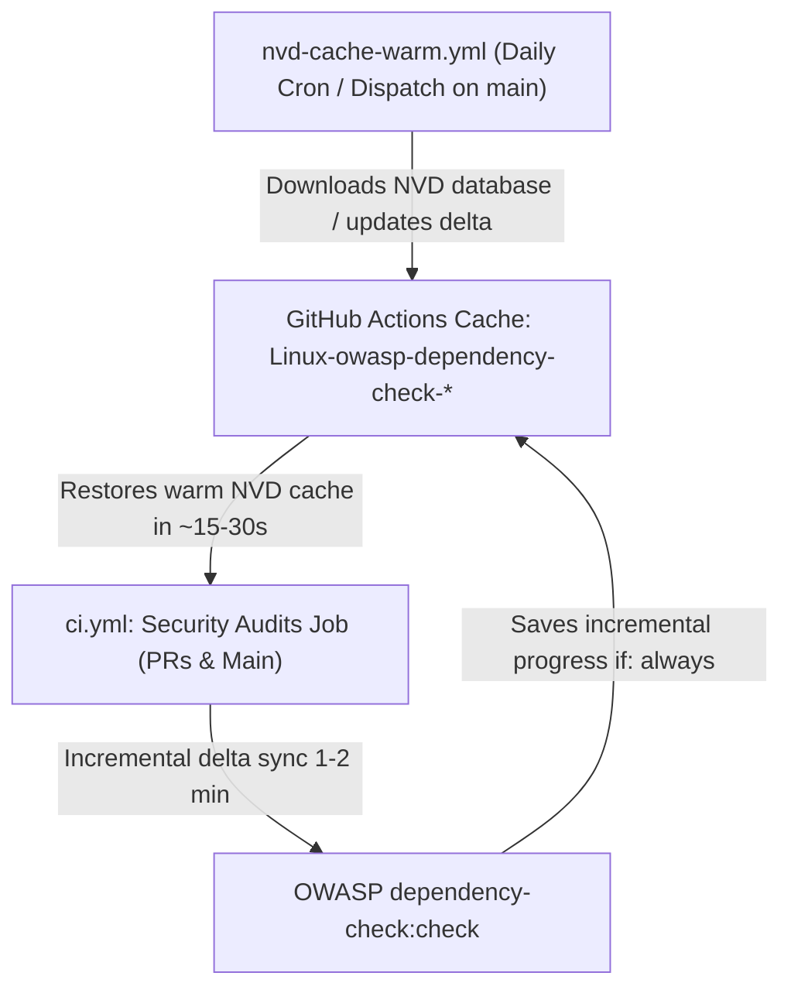

# CI Security Scanning & NVD Cache Architecture

> **Target Audience:** DevOps Engineers, Security Engineers, Repository Maintainers  
> **Status:** Authoritative CI Security & Caching Guide  
> **Applicable Workflows:** `.github/workflows/ci.yml` (Security Audits job) & `.github/workflows/nvd-cache-warm.yml`  
> **Last Updated:** 2026-11-24

---

## 1. Overview & Architecture

Velorix Sentinel executes two layers of automated dependency vulnerability audits on every pull request and push:
1. **Frontend:** `npm audit --audit-level=high` (blocking — fails the build on high/critical JavaScript vulnerabilities).
2. **Backend:** **OWASP Dependency-Check Maven Plugin** (`org.owasp:dependency-check-maven:12.1.0`) running against the National Vulnerability Database (NVD) hosted by NIST.

Because the NVD dataset contains over 430,000 CVE records, downloading the complete database from scratch on a cold runner requires substantial network time and is heavily throttled by NIST rate limits. To maintain fast, deterministic PR checks without timing out, the CI pipeline uses a two-workflow caching architecture:



---

## 2. Two-Phase Caching Mechanics

Standard GitHub Actions `actions/cache` uses a post-action save step that **only runs if the entire job finishes without being cancelled**. If a cold-cache NVD download exceeded the job timeout (e.g., 40 minutes), the cache was never saved, forcing every retry to restart at 0%.

To eliminate this vulnerability, both workflows split caching into explicit **restore** and **save** steps:

### 2.1 Restore Step (`actions/cache/restore@v4`)
Runs **before** Maven begins:
```yaml
- name: Restore OWASP Dependency-Check database cache
  uses: actions/cache/restore@v4
  with:
    path: ~/.m2/repository/org/owasp/dependency-check-data
    key: ${{ runner.os }}-owasp-dependency-check-${{ github.run_id }}-${{ github.run_attempt }}
    restore-keys: |
      ${{ runner.os }}-owasp-dependency-check-
      ${{ runner.os }}-owasp-dependency-check
```
- **Prefix Matching:** Because the exact key includes `github.run_id`, an exact hit is rare on new runs. The runner falls back to `restore-keys: ${{ runner.os }}-owasp-dependency-check-`, fetching the most recent warm cache saved on `main` or the current branch.
- **Data Directory:** Evaluates to `~/.m2/repository/org/owasp/dependency-check-data`, matching the explicit `<dataDirectory>` setting in `backend/pom.xml`.

### 2.2 Save Step (`actions/cache/save@v4`)
Runs **after** Maven with `if: always()`:
```yaml
- name: Save OWASP Dependency-Check database cache
  uses: actions/cache/save@v4
  if: always()
  with:
    path: ~/.m2/repository/org/owasp/dependency-check-data
    key: ${{ runner.os }}-owasp-dependency-check-${{ github.run_id }}-${{ github.run_attempt }}
```
- **Guaranteed Progress Persistence:** Even if the scan step experiences a network error, partial sync, or step timeout, `if: always()` executes and saves all downloaded CVE records to the cache.
- **Unique Run Keys:** Using `${{ github.run_id }}-${{ github.run_attempt }}` ensures the cache save is never skipped due to an existing cache key collision.

---

## 3. NVD API Key & Rate Limiting

NIST enforces strict rate limiting on calls to the NVD 2.0 REST API:

| Configuration Mode | Delay Between Requests (`nvdApiDelay`) | Cold Cache Full Download Time |
| :--- | :--- | :--- |
| **Unauthenticated (No Key)** | 8,000 ms (8.0 seconds) | ~60–90 minutes (exceeds standard CI timeouts) |
| **Authenticated (`NVD_API_KEY`)** | 3,500 ms (3.5 seconds) | ~15–25 minutes (delta syncs take < 2 minutes) |

### 3.1 Repository Secret Configuration
1. Request an NVD API Key from NIST at:  
   [https://nvd.nist.gov/developers/request-an-api-key](https://nvd.nist.gov/developers/request-an-api-key)
2. In the GitHub repository, navigate to **Settings** $\rightarrow$ **Secrets and variables** $\rightarrow$ **Actions**.
3. Create or update the repository secret named `NVD_API_KEY`.

### 3.2 Graceful Fallback Behavior
The workflow scripts inspect `$NVD_API_KEY` at runtime without echoing its contents:
- If present: Passes `-DnvdApiKey=$NVD_API_KEY` to Maven.
- If absent: Emits a warning (`::warning::No NVD API key provided...`) and allows Dependency-Check to proceed using unauthenticated fallback limits without crashing the pipeline.

---

## 4. Dedicated Cache Warming Workflow (`nvd-cache-warm.yml`)

The dedicated warming workflow (`.github/workflows/nvd-cache-warm.yml`) isolates heavy database downloads from pull requests.

### Key Characteristics:
- **Triggers:**
  - `schedule`: Runs daily at **02:00 UTC** (`0 2 * * *`).
  - `workflow_dispatch`: Enables manual triggering on demand.
- **Branch Restriction:** Scoped strictly to `main` (`if: github.ref == 'refs/heads/main'`).
- **Goal:** Executes `dependency-check:update-only` (downloads/updates CVE feeds without scanning project code).
- **Timeout:** Generous 90-minute ceiling (`timeout-minutes: 90`).
- **Permissions:** Restricted to `contents: read`.

### How to Manually Warm the Cache:
1. Navigate to the **Actions** tab in GitHub.
2. Under **Workflows** in the left sidebar, click **NVD Database Cache Warm**.
3. Click the **Run workflow** dropdown button.
4. Ensure branch is set to `main`, then click **Run workflow**.
5. Once completed, the warm cache is immediately available to all subsequent PRs and CI runs.

---

## 5. Key Rotation Runbook

When an NVD API key expires or requires rotation:
1. Request a new API key from NIST: [https://nvd.nist.gov/developers/request-an-api-key](https://nvd.nist.gov/developers/request-an-api-key).
2. Go to **Settings** $\rightarrow$ **Secrets and variables** $\rightarrow$ **Actions** $\rightarrow$ click on `NVD_API_KEY`.
3. Update the secret value and click **Update secret**.
4. Trigger the `NVD Database Cache Warm` workflow via `workflow_dispatch` to test authentication and warm the cache under the new key.
5. **Zero code or workflow changes are required** during secret rotation.

---

## 6. Future Enforcement: Enabling `failBuildOnCVSS=7` (Roadmap)

Currently, the OWASP scan runs in **reporting-only mode** (`failOnError=false`) to ensure PR pipelines remain fast and green while the cache warms:
- Full HTML and JSON vulnerability reports are generated and uploaded as job artifacts (`dependency-check-reports`).
- Step summaries are written directly to `$GITHUB_STEP_SUMMARY`.

### Procedure to Transition to Strict Enforcement (Future Task):
Once the cache warming workflow has run reliably on `main` and all baseline vulnerabilities are cataloged:

1. **Create an OWASP Suppression File:**  
   Create `backend/src/test/resources/dependency-check-suppressions.xml` to suppress known false positives or acceptable development dependencies.
2. **Update `backend/pom.xml`:**  
   Under `<pluginManagement>` $\rightarrow$ `dependency-check-maven`:
   ```xml
   <configuration>
       <formats>
           <format>HTML</format>
           <format>JSON</format>
       </formats>
       <outputDirectory>${project.build.directory}/dependency-check-reports</outputDirectory>
       <dataDirectory>${user.home}/.m2/repository/org/owasp/dependency-check-data</dataDirectory>
       <nvdMaxRetryCount>10</nvdMaxRetryCount>
       <!-- Transition to blocking on High/Critical CVEs (CVSS >= 7.0) -->
       <failBuildOnCVSS>7</failBuildOnCVSS>
       <suppressionFiles>
           <suppressionFile>${project.basedir}/src/test/resources/dependency-check-suppressions.xml</suppressionFile>
       </suppressionFiles>
   </configuration>
   ```
3. **Update `.github/workflows/ci.yml`:**  
   Remove `continue-on-error: true` from the `owasp-scan` step so that a CVSS $\ge 7$ vulnerability triggers a red build.
