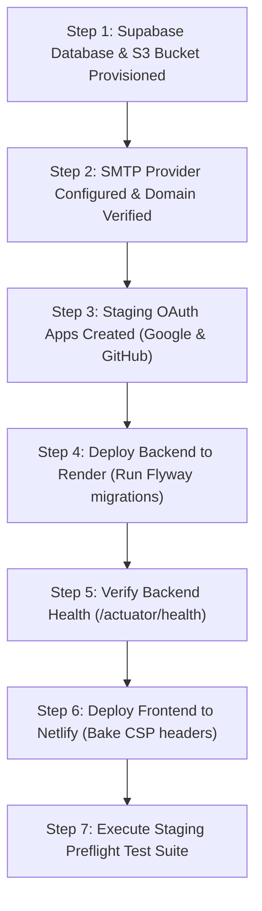

# Velorix Sentinel — Staging Environment Setup & Provisioning Runbook

> **Target Audience:** DevOps Engineers, Platform Administrators, Repository Owners  
> **Status:** Authoritative Staging Provisioning Runbook (Task 8.1)  
> **Last Updated:** 2026-11-24  
> **Architecture Target:** Netlify (Frontend SPA) + Render (Backend Docker Web Service) + Supabase (PostgreSQL 16 & S3 Object Storage) + Transactional Email (SendGrid/Resend) + OAuth 2.0 (Google & GitHub)

---

## 1. Prerequisites & Required Accounts

Before starting the provisioning process, ensure you have active administrative accounts on the following platforms:

| Platform | Required Tier | Purpose | Resources Created |
| :--- | :--- | :--- | :--- |
| **Supabase** | Free or Pro | Primary PostgreSQL 16 DB & S3 Object Storage | Staging database project, `velorix-captures-staging` storage bucket |
| **Render** | Free or Starter | Backend Spring Boot Application (Docker) | `velorix-sentinel-backend-staging` Web Service |
| **Netlify** | Free or Pro | Frontend SPA (Vite / React 18) | `velorix-sentinel-staging` Site |
| **Email Provider** | Free or Paid | Transactional Email Delivery (Verification / Passwords) | SendGrid, Resend, Mailgun, Postmark, or AWS SES SMTP credentials |
| **Google Cloud** | Standard GCP | Staging OAuth 2.0 Login | Google Cloud Console OAuth 2.0 Client credentials |
| **GitHub** | Standard User/Org | Staging OAuth 2.0 Login | GitHub Developer Settings OAuth App credentials |
| **DNS Provider** | Cloudflare / Route53 | Custom domains (optional for staging) | SPF/DKIM/DMARC TXT records for email domain verification |

### Local Tooling Requirements
- **Git** $\ge 2.40$
- **OpenSSL** $\ge 1.1.1$ (for Unix/macOS) or **PowerShell $\ge 5.1$** (for Windows)
- **cURL** $\ge 7.80$
- **Web Browser** with developer console access

---

## 2. Secret Generation Runbook

All production and staging profiles in Velorix Sentinel enforce cryptographic guardrails via `ProductionProfileValidator`. Placeholder secrets (e.g. `secret`, `changeme`, `test-secret`) or secrets shorter than 64 decoded bytes (512 bits) will **halt application startup**.

Execute the following commands in your local shell to generate cryptographically secure secrets.

### 2.1 Generating `JWT_SECRET` (HMAC-SHA512 Base64 Key)

The `JWT_SECRET` must decode to **at least 64 bytes (512 bits)** of high-entropy randomness.

#### Linux / macOS (Bash / Zsh):
```bash
# Generate 64 cryptographically random bytes encoded in Base64 (single line, no trailing newlines)
JWT_SECRET=$(openssl rand -base64 64 | tr -d '\r\n')
echo "JWT_SECRET: $JWT_SECRET"
```

#### Windows (PowerShell 5.1 / PowerShell 7+):
```powershell
# Using .NET RandomNumberGenerator to emit valid 64-byte Base64 key
$bytes = New-Object byte[] 64
[System.Security.Cryptography.RandomNumberGenerator]::Create().GetBytes($bytes)
$JWT_SECRET = [Convert]::ToBase64String($bytes)
Write-Output "JWT_SECRET: $JWT_SECRET"
```

> [!CAUTION]
> **Do NOT use string-joining character generators** like `-join ((65..90) + (97..122) | Get-Random -Count 64 | ForEach-Object {[char]$_})`.  
> That generates an alphanumeric string whose Base64 decode will either fail or yield fewer than 64 raw bytes, triggering `ProductionProfileValidator` rejection on startup!

### 2.2 Generating Database Passwords & Storage Keys

Generate high-entropy alphanumeric strings for Supabase database passwords and internal tokens:

#### Linux / macOS:
```bash
DB_PASSWORD=$(openssl rand -base64 32 | tr -dc 'a-zA-Z0-9' | head -c 24)
echo "DB_PASSWORD: $DB_PASSWORD"
```

#### Windows (PowerShell):
```powershell
$bytes = New-Object byte[] 24
[System.Security.Cryptography.RandomNumberGenerator]::Create().GetBytes($bytes)
$DB_PASSWORD = [Convert]::ToBase64String($bytes).Replace('+', '').Replace('/', '').Substring(0, 24)
Write-Output "DB_PASSWORD: $DB_PASSWORD"
```

---

## 3. Database & Object Storage Provisioning (Supabase)

### 3.1 Create Staging Database Project

1. Log in to [Supabase Dashboard](https://supabase.com/dashboard).
2. Click **New Project**.
3. Fill in project details:
   - **Organization:** Select your organization.
   - **Name:** `velorix-sentinel-staging`
   - **Database Password:** Paste the generated `$DB_PASSWORD` (save this securely).
   - **Region:** Select a region close to your Render deployment (e.g., `East US (North Virginia) - us-east-1` for Render `Oregon` or `Ohio`).
   - **Pricing Plan:** Free or Pro.
4. Click **Create new project** and wait 2–3 minutes for provisioning to complete.

### 3.2 Configure Connection Pooling (Session Pooler)

Because Render backend instances run Spring Boot with HikariCP connection pooling, you **must use the Supabase Session Pooler** (IPv4 compatible, port 5432) or configure the Transaction Pooler (port 6543) with prepared statement caching disabled.

1. Navigate to **Project Settings** (gear icon in sidebar) $\rightarrow$ **Database**.
2. Scroll to the **Connection Pooling** section.
3. Note your connection parameters:
   - **Pool Mode:** Select `Session` (port `5432`).
   - If using `Transaction` mode (port `6543`), the JDBC URL query string must include `&prepareThreshold=0` to prevent PostgreSQL prepared statement errors.
4. Construct your primary JDBC URL:
   ```
   jdbc:postgresql://aws-0-[REGION].pooler.supabase.com:5432/postgres?sslmode=require
   ```
   *Alternative Direct (IPv6 only):* `jdbc:postgresql://db.[PROJECT-REF].supabase.co:5432/postgres?sslmode=require`
5. Database Username format: `postgres.[PROJECT-REF]` (when using pooler) or `postgres` (when using direct connection).

### 3.3 Database Migrations & Flyway Execution

Velorix Sentinel manages its database schema automatically using Flyway.
- On backend startup in staging (`SPRING_PROFILES_ACTIVE=prod`), Flyway will execute migrations `V1__baseline_schema.sql` through `V10__add_missing_rls_policies.sql`.
- `spring.flyway.clean-disabled=true` is enforced to prevent destructive schema resets.

#### Manual Verification Query (Supabase SQL Editor):
After first backend startup, navigate to **SQL Editor** in Supabase and run:
```sql
SELECT version, description, type, installed_on, success 
FROM flyway_schema_history 
ORDER BY installed_rank;
```
All migrations should show `success = true`.

### 3.4 Row-Level Security (RLS) Verification

To verify that Row-Level Security is strictly enabled across every table in the public schema:
```sql
SELECT schemaname, tablename, rowsecurity 
FROM pg_tables 
WHERE schemaname = 'public' 
ORDER BY tablename;
```
Every table (including `users`, `captures`, `findings`, `user_audit_events`, etc.) must report `rowsecurity = true`.

### 3.5 Create Staging Storage Bucket (Supabase Storage / S3)

1. In Supabase Dashboard, navigate to **Storage** $\rightarrow$ **Buckets**.
2. Click **New Bucket**.
3. Name: `velorix-captures-staging`.
4. **Public bucket:** Keep **OFF** (Private bucket required).
5. File size limit: `100 MB` (matches `CAPTURE_MAX_FILE_SIZE`).
6. Allowed MIME types: leave blank or set to `application/vnd.tcpdump.pcap, application/x-pcapng, application/octet-stream`.
7. Click **Create bucket**.

### 3.6 Obtain Supabase S3 Access Keys

Supabase provides an S3-compatible API for object storage:
1. Navigate to **Project Settings** $\rightarrow$ **Storage**.
2. Under **S3 Access Keys**, click **Create Access Key**.
3. Copy the **Access Key ID**, **Secret Access Key**, and **S3 Endpoint URL**.
   - Endpoint URL format: `https://[PROJECT-REF].supabase.co/storage/v1/s3`
   - Region: `us-east-1` (Supabase S3 gateway region default).

---

## 4. Transactional Email Provisioning

Staging requires real transactional email delivery for user registration verification tokens and password reset workflows.

### 4.1 Recommended Providers
- **SendGrid:** Free tier (100 emails/day), SMTP host `smtp.sendgrid.net`, port `587`.
- **Resend:** Free tier (3,000 emails/month), SMTP host `smtp.resend.com`, port `587`.
- **Mailgun / Postmark / AWS SES:** Supported via standard SMTP.

### 4.2 Domain Verification & DNS Records
To prevent emails landing in spam during testing, add the following DNS records to your domain:
1. **SPF Record (TXT):** `v=spf1 include:sendgrid.net ~all` (or provider equivalent).
2. **DKIM Record (CNAME / TXT):** Provided in the email provider dashboard.
3. **DMARC Record (TXT):** `v=DMARC1; p=none; rua=mailto:dmarc-reports@yourdomain.com`

### 4.3 SMTP Configuration Parameters
- **Host:** `smtp.sendgrid.net` (or provider host)
- **Port:** `587`
- **Username:** `apikey` (for SendGrid) or `resend` (for Resend)
- **Password:** `<YOUR_TRANSACTIONAL_EMAIL_API_KEY>`
- **From Address:** `noreply@staging.yourdomain.com` (must match verified sender domain)

> [!WARNING]
> **Emergency Logging Fallback:**
> If email DNS verification is delayed, you can start the backend with `ALLOW_LOGGING_EMAIL_FALLBACK=true`.  
> This outputs registration tokens and password reset links to backend container logs (`stdout`) rather than sending real emails.  
> **Do not keep this setting active in staging for public testing.**

---

## 5. Backend Web Service Provisioning (Render)

### 5.1 Service Creation Walkthrough

1. Log in to [Render Dashboard](https://dashboard.render.com).
2. Click **New +** $\rightarrow$ **Web Service**.
3. Connect your repository: `https://github.com/Srvankit/velorix-sentinel-main`.
4. Configure the Web Service:
   - **Name:** `velorix-sentinel-backend-staging`
   - **Region:** `Ohio (US East)` or `Oregon (US West)` (choose closest to Supabase)
   - **Branch:** `staging` (or `feat/task-8-1-staging-provisioning` / `main`)
   - **Root Directory:** *(Leave blank — must build from repository root)*
   - **Runtime:** `Docker`
   - **Dockerfile Path:** `backend/Dockerfile`
   - **Docker Build Context:** `.` (repository root)
   - **Instance Type:** `Free` (or `Starter` to prevent cold sleeps during team testing)
5. **Health Check Path:** `/actuator/health` (Port: Render automatically injects `PORT=10000`, Spring Boot maps this to `server.port`).

### 5.2 Render Environment Variables Configuration

In the Render Web Service settings, navigate to **Environment** and add the following variables:

| Environment Variable | Primary / Alias | Value / Pattern | Sensitive | Description |
| :--- | :--- | :--- | :--- | :--- |
| `SPRING_PROFILES_ACTIVE` | Primary | `prod` | No | Activates production security guardrails |
| `PORT` | Primary | `10000` | No | Render container port (auto-set by Render) |
| `JWT_SECRET` | Primary | `<64-byte-base64-secret>` | **YES** | HMAC-SHA512 secret for JWT tokens |
| `SUPABASE_DB_URL` | Primary (`DB_URL`) | `jdbc:postgresql://aws-0-...pooler.supabase.com:5432/postgres?sslmode=require` | No | JDBC connection string |
| `SUPABASE_DB_USERNAME` | Primary (`DB_USERNAME`) | `postgres.[PROJECT-REF]` | No | PostgreSQL database user |
| `SUPABASE_DB_PASSWORD` | Primary (`DB_PASSWORD`) | `<DB_PASSWORD>` | **YES** | PostgreSQL user password |
| `FRONTEND_BASE_URL` | Primary | `https://velorix-sentinel-staging.netlify.app` | No | Origin for email links |
| `CORS_ALLOWED_ORIGINS` | Primary | `https://velorix-sentinel-staging.netlify.app` | No | Exact CORS whitelist (no wildcards) |
| `VELORIX_STORAGE_PROVIDER` | Primary | `s3` | No | Use S3-compatible cloud object storage |
| `SUPABASE_STORAGE_BUCKET` | Primary (`S3_BUCKET_NAME`) | `velorix-captures-staging` | No | Bucket name in Supabase |
| `SUPABASE_STORAGE_S3_ENDPOINT`| Primary (`S3_ENDPOINT`) | `https://[PROJECT-REF].supabase.co/storage/v1/s3` | No | S3 endpoint URL |
| `S3_REGION` | Primary (`AWS_REGION`) | `us-east-1` | No | S3 region |
| `S3_ACCESS_KEY` | Primary (`AWS_ACCESS_KEY_ID`) | `<SUPABASE_S3_ACCESS_KEY>` | **YES** | S3 API access key |
| `S3_SECRET_KEY` | Primary (`AWS_SECRET_ACCESS_KEY`)| `<SUPABASE_S3_SECRET_KEY>` | **YES** | S3 API secret key |
| `S3_PATH_STYLE_ACCESS` | Primary | `true` | No | Required for Supabase/MinIO S3 APIs |
| `SMTP_HOST` | Primary | `smtp.sendgrid.net` | No | Transactional SMTP server hostname |
| `SMTP_PORT` | Primary | `587` | No | SMTP TLS submission port |
| `SMTP_USERNAME` | Primary | `apikey` | No | SMTP username |
| `SMTP_PASSWORD` | Primary | `<EMAIL_API_KEY>` | **YES** | SMTP password / API key |
| `SPRING_SECURITY_OAUTH2_CLIENT_REGISTRATION_GOOGLE_CLIENT_ID` | Primary | `<GOOGLE_CLIENT_ID>` | No | Staging Google OAuth Client ID |
| `SPRING_SECURITY_OAUTH2_CLIENT_REGISTRATION_GOOGLE_CLIENT_SECRET` | Primary | `<GOOGLE_CLIENT_SECRET>` | **YES** | Staging Google OAuth Secret |
| `SPRING_SECURITY_OAUTH2_CLIENT_REGISTRATION_GITHUB_CLIENT_ID` | Primary | `<GITHUB_CLIENT_ID>` | No | Staging GitHub OAuth Client ID |
| `SPRING_SECURITY_OAUTH2_CLIENT_REGISTRATION_GITHUB_CLIENT_SECRET` | Primary | `<GITHUB_CLIENT_SECRET>` | **YES** | Staging GitHub OAuth Secret |
| `LOG_LEVEL_APP` | Primary | `INFO` | No | Application logging level |
| `LOG_STRUCTURED_FORMAT` | Primary | `json` | No | Render structured log format |

---

## 6. Frontend Site Provisioning (Netlify)

### 6.1 Create Staging Site

1. Log in to [Netlify Dashboard](https://app.netlify.com).
2. Click **Add new site** $\rightarrow$ **Import an existing project**.
3. Select **GitHub** and authorize access to `velorix-sentinel-main`.
4. Configure Build & Deploy settings:
   - **Site name:** `velorix-sentinel-staging` (resolves to `https://velorix-sentinel-staging.netlify.app`)
   - **Branch to deploy:** `staging` (or `feat/task-8-1-staging-provisioning` / `main`)
   - **Base directory:** *(leave blank — repository root)*
   - **Build command:** `npm run build`
   - **Publish directory:** `dist`

### 6.2 Staging Environment Variables

In **Site configuration** $\rightarrow$ **Environment variables**, set:

| Variable | Value | Description |
| :--- | :--- | :--- |
| `VITE_API_BASE_URL` | `https://velorix-sentinel-backend-staging.onrender.com` | Base URL of staging backend API |

### 6.3 CSP and Custom Headers Generation

During `npm run build`, the post-build script `scripts/generate-headers.js` runs automatically.  
It reads `VITE_API_BASE_URL` and dynamically writes `dist/_headers` ensuring:
- `connect-src 'self' https://velorix-sentinel-backend-staging.onrender.com` is baked into the Content-Security-Policy header.
- Static assets receive immutable caching headers (`Cache-Control: public, max-age=31536000, immutable`).
- `index.html` receives no-cache headers (`Cache-Control: public, max-age=0, must-revalidate`).

---

## 7. OAuth 2.0 Providers (Separate Staging Credentials)

> [!IMPORTANT]
> **NEVER reuse production OAuth credentials in staging.**  
> Using separate applications ensures staging test accounts and development redirect URIs cannot compromise production user auth.

### 7.1 Google OAuth 2.0 (Google Cloud Console)

1. Open [Google Cloud Console Credentials](https://console.cloud.google.com/apis/credentials).
2. Select or create project: `Velorix Sentinel Staging`.
3. Configure OAuth Consent Screen (External, App name: `Velorix Sentinel (Staging)`).
4. Click **Create Credentials** $\rightarrow$ **OAuth client ID**.
5. Application type: **Web application**.
6. Name: `Velorix Sentinel Staging Web Client`.
7. **Authorized JavaScript origins:**
   - `https://velorix-sentinel-staging.netlify.app`
8. **Authorized redirect URIs:**
   - `https://velorix-sentinel-backend-staging.onrender.com/login/oauth2/code/google`
9. Copy **Client ID** and **Client Secret** into Render environment variables.

### 7.2 GitHub OAuth 2.0 (GitHub Developer Settings)

1. Open [GitHub Developer Settings](https://github.com/settings/developers) $\rightarrow$ **OAuth Apps**.
2. Click **New OAuth App**.
3. Application name: `Velorix Sentinel Staging`.
4. **Homepage URL:** `https://velorix-sentinel-staging.netlify.app`.
5. Application description: `Staging environment for Velorix Sentinel network security testing`.
6. **Authorization callback URL:**
   - `https://velorix-sentinel-backend-staging.onrender.com/login/oauth2/code/github`
7. Click **Register application**.
8. Generate a new client secret.
9. Copy **Client ID** and **Client Secret** into Render environment variables.

---

## 8. Deployment & Verification Order

To prevent circular dependencies and broken initial health checks, execute the deployment in this strict order:



1. **Step 1:** Provision Supabase Database, verify Session Pooler string, create `velorix-captures-staging` bucket, and generate S3 credentials.
2. **Step 2:** Configure transactional email provider (SendGrid/Resend) and verify sender domain.
3. **Step 3:** Create staging OAuth apps in Google Cloud and GitHub Developer consoles using the planned Render and Netlify staging URLs.
4. **Step 4:** Deploy Backend Web Service to Render with all environment variables configured. Observe build and startup logs to verify:
   - Flyway successfully migrates schema (`V1` to `V10`).
   - `ProductionProfileValidator` validates all secrets and operational parameters with 0 violations.
   - Spring Boot reports `Started SentinelBackendApplication in X seconds`.
5. **Step 5:** Perform backend health check verification:
   ```bash
   curl -i https://velorix-sentinel-backend-staging.onrender.com/actuator/health
   # Expected: HTTP 200 OK, {"status":"UP"}
   ```
6. **Step 6:** Deploy Frontend to Netlify with `VITE_API_BASE_URL` configured. Verify site loads in browser with no CSP errors in console.
7. **Step 7:** Run the automated staging preflight test suite from your local machine or CI runner:
   ```bash
   ./scripts/staging-preflight.sh \
     https://velorix-sentinel-staging.netlify.app \
     https://velorix-sentinel-backend-staging.onrender.com
   ```

---

## 9. Troubleshooting & Common Failure Modes

| Symptom | Root Cause | Immediate Remediation |
| :--- | :--- | :--- |
| **Backend crashes on startup with `ProductionConfigurationException`** | Missing or invalid required env var (`JWT_SECRET`, DB URL, missing SMTP, etc.). | Check Render logs. Look for `Production configuration validation failed with N violation(s)`. Ensure `JWT_SECRET` is at least 64 decoded bytes Base64 and not a test placeholder. |
| **Backend crashes with `PSQLException: connection refused` or timeout** | Render cannot reach Supabase via direct IPv6 connection. | Change `SUPABASE_DB_URL` to use the **Supabase Session Pooler** (`aws-0-[region].pooler.supabase.com:5432`) which provides IPv4 routing. |
| **Backend crashes with `PSQLException: prepared statement "S_1" already exists`** | Transaction pooler (port 6543) used with prepared statement caching. | Use Session pooler (port 5432) OR append `&prepareThreshold=0` to the JDBC connection string. |
| **Frontend console displays `CORS error: No 'Access-Control-Allow-Origin' header`** | Backend `CORS_ALLOWED_ORIGINS` does not match the Netlify staging URL exactly. | Check `CORS_ALLOWED_ORIGINS` on Render. Ensure protocol (`https://`), domain, and lack of trailing slash match `https://velorix-sentinel-staging.netlify.app` exactly. |
| **Browser console displays `Refused to connect because it violates CSP directive connect-src`** | Netlify CSP headers were baked without staging backend URL. | Ensure `VITE_API_BASE_URL` was set in Netlify site settings **before** build, and trigger a cache-cleared redeploy on Netlify. |
| **Render Web Service spins for 60 seconds on first request** | Render Free Tier spins down idle web services after 15 minutes of inactivity. | Expected behavior on Free tier. Preflight scripts include automated exponential backoff retry logic. Upgrade to Starter tier to prevent cold sleeps. |
| **OAuth login redirects with `redirect_uri_mismatch`** | Redirect URI in Google/GitHub console does not match Render backend callback. | Ensure Google/GitHub authorized redirect URI is exactly `https://[RENDER-BACKEND]/login/oauth2/code/[google|github]` with no trailing slash. |
| **Registration emails not arriving** | SMTP credentials incorrect or sender domain not verified. | Check Render logs for `MailSendException`. For emergency debugging, set `ALLOW_LOGGING_EMAIL_FALLBACK=true` to view links in container logs. |

---

## 10. Secrets & Environment Variables Master Checklist

Use this table to audit your secrets before executing staging deployment:

| Variable Name | Target System | Minimum Entropy / Format | Sensitive? | Purpose |
| :--- | :--- | :--- | :--- | :--- |
| `JWT_SECRET` | Render | 64 decoded bytes Base64 | **YES** | User JWT signing / verification |
| `SUPABASE_DB_PASSWORD` | Render | 24+ chars alphanumeric | **YES** | Database authentication |
| `SUPABASE_DB_URL` | Render | JDBC URL (`jdbc:postgresql://...`) | No | Database connection string |
| `SUPABASE_DB_USERNAME` | Render | String (`postgres.[ref]`) | No | Database user |
| `FRONTEND_BASE_URL` | Render | HTTPS URL | No | Frontend link base in emails |
| `CORS_ALLOWED_ORIGINS` | Render | HTTPS URL | No | Allowed CORS origin |
| `S3_ACCESS_KEY` | Render | 20+ chars alphanumeric | **YES** | S3 API authentication |
| `S3_SECRET_KEY` | Render | 40+ chars Base64/alphanumeric | **YES** | S3 API authentication |
| `SMTP_PASSWORD` | Render | Provider API key | **YES** | Transactional email auth |
| `GOOGLE_CLIENT_SECRET` | Render | GCP Client Secret | **YES** | Google OAuth authentication |
| `GITHUB_CLIENT_SECRET` | Render | GitHub Client Secret | **YES** | GitHub OAuth authentication |
| `VITE_API_BASE_URL` | Netlify | HTTPS URL | No | API base for frontend SPA |
