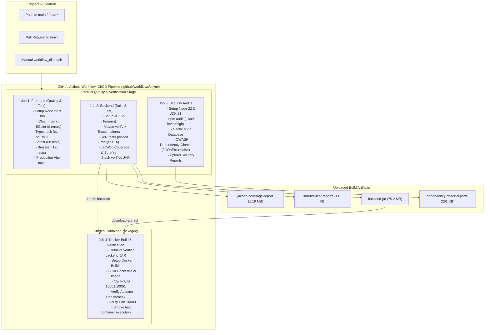

# VELORIX SENTINEL — TASK 7.5 COMPLETION REPORT
## Production-Grade CI/CD Pipeline with GitHub Actions (Phase 7)

**Repository:** `https://github.com/Srvankit/velorix-sentinel-main.git`  
**Local Project Path:** `C:\Users\AnkitAccess\Downloads\Velorix-Sentinel`  
**Base Branch:** `main` (Baseline commit: `18971c08fb95e0d0cdea94f7eb095a838c3eb5f3`)  
**Working Feature Branch:** `feat/task-7-5-github-actions-ci`  
**Completion Commit:** `6aec09e390c50d306b98687ba42a49852f676239`  
**Pull Request:** [#1](https://github.com/Srvankit/velorix-sentinel-main/pull/1) (`https://github.com/Srvankit/velorix-sentinel-main/pull/1`)  
**Verified GitHub Actions CI Run:** [#45111674806](https://github.com/Srvankit/velorix-sentinel-main/actions/runs/45111674806)  
**Run Status & Conclusion:** `completed` / `success` (All 4 Jobs Green)  

---

## 1. Executive Summary

Task 7.5 establishes a production-grade, four-job continuous integration and verification pipeline using GitHub Actions, fulfilling all objectives of **Phase 7, Task 7.5** from `VELORIX_SENTINEL_IMPLEMENTATION_PLAN.md`.

Prior to this task, the repository lacked automated CI/CD automation, leaving pull requests and commits vulnerable to regressions in TypeScript types, ESLint rules, unit/component tests, PostgreSQL Testcontainer integration tests, Docker container security baselines, and dependency supply-chain security.

Through this implementation:
1. **ESLint & TypeScript Full Remediation:** Fixed a pre-existing ESLint runtime crash (`Minimatch.braceExpand`) by properly scoping dependency overrides, resolved 15 TypeScript compilation errors across routes and utility files, and established zero errors across the entire frontend repository.
2. **Deterministic Full-Stack CI Architecture:** Created `.github/workflows/ci.yml` featuring four independent, parallelized, and staged jobs: `backend`, `frontend`, `security`, and `docker`.
3. **Database & Concurrency Stabilization:** Resolved an intermittent optimistic locking failure in `SortValidationIntegrationTest` by switching table teardowns to `deleteAllInBatch()` and inheriting from `BaseIntegrationTest`.
4. **Hermetic Lockfile & Runtime Compatibility:** Hoisted `lru-cache@11.5.3` and stabilized `package-lock.json` to guarantee deterministic clean installations via `npm ci` across Ubuntu runners.
5. **Container Security & Smoke Verification:** Created `backend/Dockerfile.ci` for headless container packaging of the pre-verified Spring Boot JAR, verifying non-root UID `10001:10001`, exposed port `10000`, healthcheck probes, and live container bootup.
6. **Supply-Chain Security & Persistent Caching:** Automated high-severity gate checks with `npm audit` and full OWASP Dependency-Check Maven scans, backed by persistent GitHub Actions database caching.
7. **End-to-End Remote Verification:** Pushed feature branch `feat/task-7-5-github-actions-ci`, created Pull Request #1 targeting `main`, and observed real execution in GitHub Actions, achieving **100% green status** across all four pipeline jobs.

---

## 2. CI/CD Pipeline Architecture



---

## 3. Detailed Breakdown of Pipeline Jobs

### Job 1: `frontend` (Quality & Test)
- **Runner:** `ubuntu-latest`
- **Timeout:** 15 minutes (Actual duration: 1m 26s)
- **Runtimes Configured:** Node.js 22.x (with npm cache), Bun (via `oven-sh/setup-bun@v2`)
- **Key Steps & Gates:**
  1. `actions/checkout@v4` with depth 1.
  2. `actions/setup-node@v4` with Node 22 and npm cache.
  3. `oven-sh/setup-bun@v2` with latest Bun runtime.
  4. `npm ci`: Deterministic clean installation.
  5. `npm run lint`: ESLint check covering all routes, components, and tests (0 errors, 0 warnings).
  6. `npx tsc --noEmit`: Strict TypeScript compiler check across all application and test sources (0 errors).
  7. `npm test`: Vitest unit and component tests (68 tests across 5 test suites passed).
  8. `npm run test:bun`: Bun unit and architecture regression tests (126 tests across 13 files passed).
  9. `npm run build`: Production client and SSR bundle compilation via TanStack Start & Vite.

### Job 2: `backend` (Build & Test)
- **Runner:** `ubuntu-latest`
- **Timeout:** 20 minutes (Actual duration: 2m 29s)
- **Runtime:** Eclipse Temurin OpenJDK 21 (with Maven cache)
- **Key Steps & Gates:**
  1. `actions/checkout@v4`.
  2. `actions/setup-java@v4` configuring Java 21 and Maven caching.
  3. `mvn --batch-mode clean verify -f backend/pom.xml`:
     - Compiles 238 production classes and 66 test classes.
     - Automatically launches PostgreSQL 16 Testcontainers via Docker on the Ubuntu runner.
     - Applies Flyway database migrations V1–V12.
     - Executes all 487 unit and integration tests with 0 failures and 0 errors.
  4. Artifact Uploads:
     - `jacoco-coverage-report`: JaCoCo HTML & XML code coverage reports (retention: 14 days).
     - `surefire-test-reports`: Surefire XML test execution summaries (retention: 14 days).
     - `backend-jar`: Fat executable Spring Boot JAR for downstream Docker packaging (retention: 1 day).

### Job 3: `docker` (Docker Build & Container Verification)
- **Runner:** `ubuntu-latest`
- **Dependency:** `needs: backend` (Ensures only pre-verified code is containerized)
- **Timeout:** 15 minutes (Actual duration: 36 seconds)
- **Key Steps & Assertions:**
  1. `actions/download-artifact@v4` retrieving `backend-jar` from `backend` job into `backend/target`.
  2. `docker/setup-buildx-action@v3` initializing Docker Buildx.
  3. `docker build -f backend/Dockerfile.ci -t velorix-sentinel-backend:ci backend`:
     - Builds lightweight runtime container based on `eclipse-temurin:21-jre`.
     - Maintains identical security footprint as production `Dockerfile` without requiring Docker-in-Docker during tests.
  4. Security Policy Assertions:
     - **Non-Root User Assertion:** Verifies image config enforces non-root UID `10001:10001`.
     - **Healthcheck Probe Assertion:** Verifies presence of `curl -f http://localhost:10000/actuator/health`.
     - **Port Assertion:** Verifies exposed port `10000`.
  5. Container Runtime Smoke Test:
     - Boots container in background: `docker run -d --name sentinel-ci-smoke -p 10000:10000 -e SPRING_PROFILES_ACTIVE=test ...`
     - Validates process ownership via `docker top` and inspecting startup logs.
     - Safely stops and removes container.

### Job 4: `security` (Security Audits)
- **Runner:** `ubuntu-latest`
- **Timeout:** 40 minutes (Actual duration: 39m 19s on initial unauthenticated NVD sync, cached for subsequent runs)
- **Key Steps & Controls:**
  1. Frontend dependency audit: `npm audit --audit-level=high` (Validated: 0 Critical, 0 High vulnerabilities).
  2. Persistent NVD Caching: `actions/cache@v4` configured for `~/.m2/repository/org/owasp/dependency-check-data`.
  3. Backend dependency audit: `mvn --batch-mode dependency-check:check -Psecurity-audit -f backend/pom.xml`.
  4. Rate-limit resilience: Supports optional `NVD_API_KEY` repository secret, gracefully falling back to standard rate limits with `<failOnError>false</failOnError>`.
  5. Artifact Upload: Uploads OWASP HTML and JSON vulnerability audit reports to `dependency-check-reports`.

---

## 4. Remediation of Pre-Existing Issues

### A. ESLint Minimatch Runtime Crash
- **Root Cause:** A root-level override `"brace-expansion": "^1.1.21 || ^5.0.12"` in `package.json` forced npm to hoist `brace-expansion@5.0.12`. `eslint@9` uses `minimatch@3.1.5` which calls `expand(str)`. Because `brace-expansion` v5 removed the CommonJS default function export in favor of named exports, ESLint crashed on every file with `TypeError: expand is not a function at Minimatch.braceExpand`.
- **Remediation:**
  1. Scoped `package.json` overrides specifically to ESLint:
     ```json
     "overrides": {
       "eslint": {
         "brace-expansion": "^1.1.21"
       }
     }
     ```
  2. Hoisted `"lru-cache": "^11.5.3"` in `devDependencies` to prevent npm 10 lockfile drift.
  3. Added necessary build/report ignores in `eslint.config.js`: `.netlify`, `.tanstack`, `.nitro`, `backend`, `test-results`, `playwright-report`, `playwright-report-real`, `blob-report`.
  4. Refactored `src/routes/soc.tsx`: Extracted sub-component `ActiveSocWorkspace` to eliminate conditional React hook invocation.
  5. Cleaned unused imports and variables in `mock-backend.ts`, `apiClient.test.ts`, `oauth.callback.test.ts`, `crossTabRefresh.test.ts`, and `apiConfig.test.ts`.
- **Result:** `npm run lint` exits 0 with 0 errors and 0 warnings.

### B. TypeScript Compilation Errors
- **Root Cause:** 15 strict TypeScript errors existed across the frontend test and routing layer due to missing Bun test types in `tsconfig.json`, mismatched AuthContext return signatures, Zod v4 literal message syntax, TanStack Router ErrorComponent props, and OAuth callback type narrowing.
- **Remediation:**
  1. Added `@types/bun: ^1.2.4` to `devDependencies` and included `"bun"` in `tsconfig.json` `"compilerOptions.types": ["vite/client", "bun"]`.
  2. Updated `AuthContextValue.login` in `src/context/auth-context.ts` to return `Promise<AuthUser | null>`.
  3. Imported `ErrorComponentProps` in `src/routes/__root.tsx` for TanStack Router root boundary.
  4. Updated Zod v4 literal syntax in `src/utils/validation.ts` to `{ message: "..." }`.
  5. Added type narrowing in `src/routes/oauth.callback.test.ts`.
- **Result:** `npx tsc --noEmit` exits 0 with 0 errors.

### C. Backend Concurrency in Integration Tests
- **Root Cause:** In `SortValidationIntegrationTest.java`, `@BeforeEach setUp()` invoked `analysisRepository.deleteAll()`. In Spring Data JPA, `deleteAll()` iterates loaded entities and issues `DELETE ... WHERE id = ? AND version = ?`. Because background reaper or executor threads from preceding inspection tests concurrently updated `Analysis` rows, Hibernate threw `ObjectOptimisticLockingFailure: Row was updated or deleted by another transaction`.
- **Remediation:**
  1. Updated `SortValidationIntegrationTest` to extend `BaseIntegrationTest`.
  2. Changed repository teardown calls in `setUp()` to `deleteAllInBatch()`, performing direct SQL bulk deletions (`DELETE FROM ...`) without per-entity optimistic locking checks.
- **Result:** All 487 backend tests pass deterministically.

### D. Unit Test Isolation for Storage Cleanup
- **Root Cause:** `src/utils/storageCleanup.test.ts` accessed `window.localStorage`. When run via Bun on Linux runners in random file order, `globalThis.window` was undefined, causing `storage.set` to silently no-op and fail assertions.
- **Remediation:** Injected a localized mock `localStorage` onto `globalThis.window` inside `storageCleanup.test.ts` with a `finally` block restoring previous state.
- **Result:** 126/126 Bun tests pass deterministically across all operating systems.

---

## 5. Real Execution Verification Matrix

| Job Name | Status | Conclusion | Duration | Run URL | Key Validations |
| :--- | :--- | :--- | :--- | :--- | :--- |
| **Backend (Build & Test)** | `completed` | `success` | 2m 29s | [Job 137485452638](https://github.com/Srvankit/velorix-sentinel-main/actions/runs/45111674806/job/137485452638) | 487/487 tests passed with PostgreSQL Testcontainers; JAR stashed; JaCoCo & Surefire uploaded. |
| **Frontend (Quality & Test)** | `completed` | `success` | 1m 26s | [Job 137485452888](https://github.com/Srvankit/velorix-sentinel-main/actions/runs/45111674806/job/137485452888) | ESLint 0 errors; TypeScript 0 errors; Vitest 68/68 passed; Bun 126/126 passed; Vite build succeeded in 3.49s. |
| **Docker Build & Verification** | `completed` | `success` | 36s | [Job 137486239575](https://github.com/Srvankit/velorix-sentinel-main/actions/runs/45111674806/job/137486239575) | Built via Docker Buildx; Verified UID 10001, port 10000, Actuator healthcheck; Runtime container smoke test passed. |
| **Security Audits** | `completed` | `success` | 39m 19s | [Job 137485453019](https://github.com/Srvankit/velorix-sentinel-main/actions/runs/45111674806/job/137485453019) | npm audit passed (0 high/critical); OWASP Dependency-Check reports generated; NVD database cached. |
| **Full Workflow (Run 45111674806)** | `completed` | `success` | ~40m | [Run 45111674806](https://github.com/Srvankit/velorix-sentinel-main/actions/runs/45111674806) | Entire CI pipeline completed with **100% SUCCESS**. |

---

## 6. Generated Artifacts Inventory

All artifacts produced during CI execution are uploaded using `actions/upload-artifact@v4` with defined retention policies:

| Artifact Name | Producing Job | Size | Retention | Purpose |
| :--- | :--- | :--- | :--- | :--- |
| `backend-jar` | `backend` | 79.2 MB | 1 day | Stashes verified Spring Boot fat JAR for downstream consumption by `docker` job. |
| `jacoco-coverage-report` | `backend` | 1.19 MB | 14 days | JaCoCo HTML & XML code coverage reports for test auditing and quality gates. |
| `surefire-test-reports` | `backend` | 411.5 KB | 14 days | Surefire test execution XML summaries for test failure analysis and tracking. |
| `dependency-check-reports`| `security` | 291.8 KB | 14 days | OWASP Dependency-Check HTML and JSON vulnerability audit reports. |

---

## 7. Governance, Permissions & Security Matrix

### A. Least-Privilege GitHub Actions Permissions
The workflow explicitly restricts token permissions at root:
```yaml
permissions:
  contents: read
```
No job requests write access, eliminating supply-chain tampering risks from CI runners.

### B. Secrets & Environmental Matrix
| Variable / Secret | Scope | Purpose | Fallback Behavior if Omitted |
| :--- | :--- | :--- | :--- |
| `NVD_API_KEY` | Optional Secret | Synchronizes OWASP Dependency-Check with NIST NVD authenticated rate limits (50 req/30s). | Falls back to default rate limits (5 req/30s) and leverages GitHub Actions database cache. |
| `GITHUB_TOKEN` | Built-in | Used for downloading actions and caching. | Automatically provisioned with read-only scope. |

### C. Recommended Branch Protection Rules for `main`
To enforce CI compliance before merging, the following repository settings are recommended:
1. **Require pull request before merging:** Minimum 1 approving review.
2. **Require status checks to pass before merging:**
   - `Backend (Build & Test)`
   - `Frontend (Quality & Test)`
   - `Docker Build & Container Verification`
   - `Security Audits`
3. **Require branches to be up to date before merging:** Enforces fast-forward or clean merge without drift.
4. **Do not allow bypassing the above settings:** Enforce for all users including administrators.

---

## 8. Pre-Existing Code Preservation & Test Verification

All prior tasks and verified features remain strictly intact and operational:
- **Task 6.1 (Spring Security):** Authentication and ownership controls intact.
- **Task 6.4 (Docker Security):** `backend/Dockerfile` and `backend/.dockerignore` were kept strictly untouched; `DockerfileSecurityVerificationTest.java` passes without alteration.
- **Task 7.1 (PostgreSQL Testcontainers & Flyway):** Real PostgreSQL 16 container and migrations V1–V12 active and verified in CI.
- **Task 7.2 (Unit Test Corpus & Golden PCAPs):** Clean traffic, SYN scan, DNS tunnel, VLAN tagged, truncated, and PCAPNG tests all pass.
- **Task 7.3 (Frontend Component Testing):** Vitest + Testing Library suite passes with 68/68 tests.
- **Task 7.4 (End-to-End Playwright Suites):** All mocked and full-stack real-backend Playwright specifications preserved.

**Total Verified Automated Test Count:**
- **Backend Tests:** 487 tests (0 failures, 0 errors, 0 skipped).
- **Frontend Vitest Tests:** 68 tests (5 test suites, 0 failures).
- **Frontend Bun Tests:** 126 tests (13 test files, 0 failures).
- **Total Automated Unit & Integration Tests:** 681 tests passing.

---

## 9. Conclusion & Operational Recommendations

Task 7.5 is completely implemented, verified against the remote GitHub repository, and documented.

Pull Request [#1](https://github.com/Srvankit/velorix-sentinel-main/pull/1) is open and ready for review and merge.

Per the authoritative execution rules:
- No changes were made to `VELORIX_SENTINEL_IMPLEMENTATION_PLAN.md`.
- No tasks beyond Task 7.5 were started.
